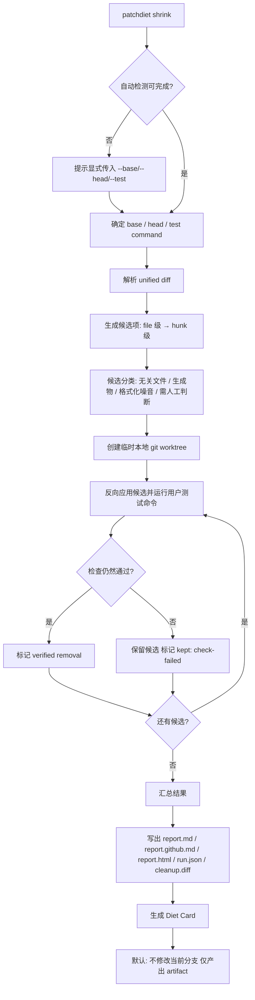
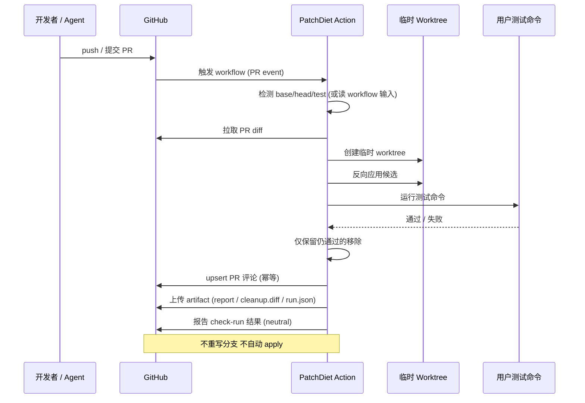

# PatchDiet v1 功能规格书（PRD）

**日期**：2026-09-26
**类型**：PRD / 功能规格书
**参与成员**：析客（需求分析师）、瑞思（用户研究员）、竞析（竞品分析师）、数析（数据分析师）、路径（路线图规划师）
**产品名称**：PatchDiet
**所属行业**：开发者工具 / DevTools · AI 编码工作流基础设施
**目标用户**：使用 AI coding agent 产出 PR 的中小软件团队与独立开发者

---

## 📌 TL;DR（执行摘要）

- **核心目标**：把 PatchDiet 从"本地可运行的产品雏形"升级为**可公开安装、可信、可验证**的 AI PR 瘦身层，让 AI 生成的过大 PR 在进入人工审查前被压缩，且每次移除都有测试证据。
- **关键决策**：坚持 **local-first + no source upload + no LLM required + test-verified removals** 作为不可妥协的产品契约；不做 AI reviewer，只做 reviewer 之前的 diff 压缩门。
- **关键决策**：北极星指标定为 `Verified Removed Review Surface`（经测试验证真正移除的 diff 面积占比），而不是评论数或活跃度。
- **下一步**：先补齐 npm 真实发布与真实仓库验证（P0），再扩张分发（GitHub Marketplace / VS Code），最后进入团队治理与商业化能力。

---

## 🎯 核心结论卡片

| 项目 | 内容 |
|------|------|
| 推荐方案 | 定位为 "AI-generated PR cleanup layer"，以 CLI + GitHub Action 双入口切入，先做可信度再做规模 |
| 优先级 | P0：发布就绪与真实仓库验证；P1：分发扩张与 benchmark；P2：团队治理与商业化 |
| 预期影响 | 削减 reviewer 需要阅读的 diff 面积（本地示例口径 75% changed-line 削减），降低审查疲劳与漏审风险 |
| 资源需求 | 1 名维护者 + 外部依赖（npm 账号、Marketplace 审核、App 托管、法务/计费） |
| 风险等级 | **中高** —— 主要风险来自 AI reviewer 平台向上覆盖 cleanup 能力，以及"误删必要代码"的信任门槛 |

---

## 产品背景与假设声明

### 背景（Evidence）

PatchDiet 是一个已具备完整工程骨架的开发者工具：

- **形态**：Node.js CLI（`init` / `doctor` / `check` / `shrink` / `report` / `card`）+ GitHub Action（`action.yml`）+ VS Code 扩展（`.vsix` 可打包）+ GitHub App 骨架（webhook server / JWT / installation token / PR diff 获取 / comment upsert 已本地可跑）。
- **核心引擎**：解析 unified diff → 按 file / hunk 生成候选项 → 在临时本地 git worktree 中反向应用候选项 → 运行用户自己的测试命令 → **仅当检查仍然通过时才移除** → 输出 `cleanup.diff`。
- **产物**：`.patchdiet/report.md`、`report.github.md`、`report.html`、`run.json`、`cleanup.diff`，以及 Diet Card（HTML / SVG / PNG + badge markdown）。
- **安全契约**：local-first、不上传源码、不需要 LLM、测试验证移除、默认不重写当前分支、cleanup patch 单独生成。
- **已验证示例**：`examples/ts-bloated-pr`、`examples/python-agent-refactor`、`examples/monorepo-scope-creep`；公开发布口径示例为 4 files / 128 changed lines → 2 files / 32 changed lines（75% 削减，`node --test` 仍通过）。

### 假设声明（Assumption，需真实数据验证）

由于本次任务未提供真实用户访谈与线上遥测数据，以下内容基于**合理假设**开展，并在全文以 `[Assumption]` 标注：

1. `[Assumption]` AI coding agent（Claude Code / Codex / Cursor / OpenHands / Copilot coding agent 等）的普及持续提升 PR 体量与"混入无关改动"的发生率。
2. `[Assumption]` 开发者对 PR 审查的耐心是稀缺资源，diff 面积是审查负担的首要代理变量。
3. `[Assumption]` 开发者愿意为"经过测试验证的移除"付费，而不只是为"建议/评论"付费。
4. `[Assumption]` 中小团队（5-30 人）是首个可触达的付费单元。
5. `[Assumption]` "不上传源码"对中大型组织是采购的必要条件而非加分项。

> 上述假设的验证方法见第 3 章与第 10 章。

---

## 1. 产品目标（3 个清晰、正交的目标）

| # | 目标 | 说明 | 正交性 |
|---|------|------|--------|
| G1 | **可信发布**：让任何开发者能在 5 分钟内完成安装并在自己的仓库跑出可解释结果 | npm 真实发布、安装冒烟、`doctor` 自诊断、报告可读且解释每个移除原因 | 解决"能不能用" |
| G2 | **有效瘦身**：在真实 AI 生成 PR 上稳定产出可验证的 diff 面积下降 | 提升候选分类准确率、支持依赖感知分组与 AST atoms、维持误删率护栏 | 解决"有没有用" |
| G3 | **可信审计**：每一次移除都可追溯、可回滚、可复现 | cleanup receipt 结构化、`run.json` 字段完备、worktree 隔离、默认不重写分支 | 解决"敢不敢用" |

三个目标互相支撑但不重叠：G1 是分发前提，G2 是价值核心，G3 是信任与规模化前提。任何单一目标达成都不足以让产品进入公开交付状态。

**目标达成的量化门禁**（[Assumption]，需真实数据校准）：
- G1：新用户在无协助情况下 5 分钟内完成一次成功的 `shrink`。
- G2：在真实仓库样本集上 verified removal ratio 中位数 ≥ 30%，且误删回滚率 ≤ 1%。
- G3：100% 的移除项在报告中带 reason code 与对应通过的测试命令。

---

## 2. 用户故事（5 个场景）

### 场景 A —— Tech Lead 的 intake gate（主要路径）

> 作为一支 12 人团队的 Tech Lead，我们的后端 AI agent 昨晚提交了一个 PR：改了 6 个文件、加了 3 篇无关文档、还顺手"优化"了格式化。测试全绿，但没人愿意认真看。
> 我希望在请 reviewer 之前，先把这堆无关改动摘出去，只留下有行为变化的那部分。
> **触发时机**：agent 提交 PR、CI 通过之后，人在 Slack 里还没开始分配 reviewer 之前。
> **期望结果**：PR 变小、reviewer 只看到行为改动、每条移除都有证据可查。

### 场景 B —— DevEx 工程师建立团队级护栏

> 作为平台/DevEx 工程师，我被要求"让 AI 生成的代码进来但别让 review 崩掉"。我不能接受把源码传到第三方云。
> 我需要在 CI 里加一个步骤：本地跑清理、产出 artifact、把结果作为 check 呈现，但**绝不重写分支**。
> **触发时机**：CI 流水线中、测试步骤之后。
> **期望结果**：可配置的策略、可审计的日志、误删时自动回退到原始 diff。

### 场景 C —— 独立开发者的自助清理

> 作为独立开发者 / 开源维护者，我自己写代码也自己审。我用 AI 大规模产码，PR 里经常混进 scratch 文件和实验代码。
> 我不想注册账号、不想上传代码、不想多花钱。
> **触发时机**：本地 commit 之后、`git push` 之前。
> **期望结果**：一条命令拿到更小的 cleanup patch，看得懂就能 `git apply`，看不懂就不 apply。

### 场景 D —— 误删发生后的追责与回滚（失败路径，必须被设计）

> 作为 reviewer，我应用了 cleanup patch 之后发现某处配置被删了，线上出问题。
> 我需要立刻知道：删了什么、当时跑的是哪个测试命令、为什么这个测试没拦住。
> **触发时机**：cleanup patch 被 apply 之后发生故障。
> **期望结果**：`run.json` + `report.md` 完整还原决策链，一条命令回滚到原始 diff。

### 场景 E —— AI agent 自动清理自身产出（自动化路径）

> 作为把 Claude Code / Cursor / Aider 接进工作流的团队，我们希望 agent 在 commit 之后自动跑一次清理，并把 cleanup patch 作为**独立建议**附在 PR 里。
> **触发时机**：agent post-commit hook。
> **期望结果**：清理结果以独立 artifact 出现，不改变 agent 的原始提交，人可以选择性采纳。

---

## 3. 用户研究洞察（来自瑞思 · 用户研究员）

> 标注说明：`Evidence` = 来自公开产品事实或可复现 demo；`Inference` = 从 AI PR 增长与 review bottleneck 推导；`Assumption` = 需真实调研确认。

### 3.1 目标用户画像（Persona）

| 维度 | P1 · Tech Lead / 技术负责人 | P2 · 平台 / DevEx 工程师 | P3 · 独立开发者 / 开源维护者 |
|------|------------------------------|--------------------------|------------------------------|
| 团队规模 | 5-30 人 | 30-300 人 | 1 人（或松散社区） |
| 日常工作流 | 分配 reviewer、看 CI、推进发布节奏 | 维护 CI/CD、研发效能指标、工具链治理 | 自己写、自己审、自己发布 |
| 与 AI agent 的关系 | 团队成员大量使用 agent，产出汇入同一仓库 | 为全组织提供 agent 使用规范与护栏 | 个人重度使用 agent 产码 |
| 关键 JTBD | 让 review 队列不因 AI PR 而失控 | 让 AI 代码进来但风险可控可审计 | 让我的 PR 干净到我自己愿意审 |
| 成功指标 | reviewer 人均待审 diff 下降、PR 周期缩短 | 误删率、CI 时间开销、工具采纳率 | 提交前 diff 更小、无额外注册摩擦 |
| 付费决策权 | **高**（可直接批准团队预算） | **中高**（影响采购但常需上报） | **低**（对免费档高度敏感） |
| 对 PatchDiet 的核心诉求 | 一键跑通 + 报告能说服 reviewer | 策略可配置 + 审计日志 + 不上传源码 | 零配置 + 本地 + 免费 |

`Evidence`：三类角色的工作边界来自 PatchDiet 现有形态（CLI / Action / VS Code / App）所对应的典型接入口。
`Inference`：付费决策权与团队规模的对应关系来自常见 DevTools 采购路径。
`Assumption`：P1 是首个付费单元 —— 需真实付费意愿调研确认。

### 3.2 核心 JTBD（Jobs To Be Done）

> **当我的 AI agent 提交了一个测试通过、但过大或混入无关改动的 PR 时，我要在请人 review 之前把它变小，这样 reviewer 只需要看真正有行为变化的代码。**

`Inference`，此 JTBD 是 PatchDiet 全部功能的收敛点：任何与"让 reviewer 少看东西且不降低安全性"无关的功能，都属于范围蔓延。

### 3.3 核心使用场景与插入点

| # | 触发时机 | 用户动作 | 期望结果 | 插入位置 |
|---|----------|----------|----------|----------|
| S1 | agent 提交 PR、CI 绿 | `patchdiet shrink` 或等 Action 跑完 | 拿到 cleanup.diff 与报告，决定是否 apply | **review 之前** |
| S2 | PR 已开、人还没审 | 在 PR 评论里看到清理摘要 | reviewer 直接看更小的 diff | review 分配时 |
| S3 | 本地 commit 后、push 前 | 本地跑一次 shrink | 只推干净的 diff | 提交前 |
| S4 | agent hook 触发 | 自动跑 shrink 并附 artifact | 清理建议自动出现，不阻塞 agent | agent 工作流尾部 |
| S5 | cleanup 出错后 | 查 run.json 并回滚 | 决策链可还原、可回退 | 故障响应 |

### 3.4 痛点与既有替代方案（无 PatchDiet 时）

| 现有做法 | 问题 | PatchDiet 的对应价值 |
|----------|------|----------------------|
| 人工删减无关改动 | 纯手工、易漏、耗 reviewer 时间 | 自动生成候选 + 测试验证 |
| 要求 agent 重写一遍 | 成本高、结果不确定、可能引入新问题 | 在既有 diff 上做减法，不改写来源 |
| 拆成多个 stacked PR | 增加分支管理复杂度 | 不重建工作流，在 intake 阶段压缩 |
| 直接接受大 diff、降低审查深度 | **最危险**：漏审风险上升 | 让"认真审"变成可行选项 |
| 只靠 lint / formatter | 只能处理格式类噪音 | 处理"不是 bug 但也不该在 PR 里"的改动 |

### 3.5 采纳障碍与化解方式

| # | 障碍（`Assumption`，需访谈验证） | 化解方式 |
|---|----------------------------------|----------|
| B1 | **怕删掉必要代码** —— 最大的信任门槛 | 测试验证移除 + 默认不重写分支 + 一键回滚 + 每条移除给 reason code |
| B2 | 多一步流程的摩擦 | 零配置自动检测 base/head/test；Action 中一个 YAML 块接入 |
| B3 | CI 时间成本 | 测试结果缓存 + 并行 worktree pool + 记录测试耗时并在报告中披露 |
| B4 | 工具疲劳（又要装一个） | 单命令 + 免费公开仓库档 + 与现有 agent hook 集成而不是新增入口 |
| B5 | 清理后谁来担责的问责模糊 | cleanup receipt 明确记录"删了什么、为什么删、通过了什么检查" |

### 3.6 可验证的研究假设

| 编号 | 假设 | 验证方法 | 证伪条件 |
|------|------|----------|----------|
| H1 | AI 生成 PR 的"无关改动占比"显著高于人工 PR | 采集真实 PR 样本做文件级人工标注 | 两者分布无显著差异 |
| H2 | `verified removal ratio` 与 reviewer 审查时间下降正相关 | A/B：装了 vs 没装 PatchDiet 的团队对比审查时长 | 装了之后审查时长无变化 |
| H3 | 用户为"测试验证的移除"付费意愿 > 为"建议"付费意愿 | 定价意愿访谈 + 假门测试 | 两者无差异 |
| H4 | "不上传源码"是中小团队采纳的必要条件 | 采纳障碍访谈（P1/P2） | 用户接受云端上传 |
| H5 | 误删事件会显著降低留存，即使可回滚 | 埋点：误删后 7 日留存对比 | 误删后留存无变化 |
| H6 | 零配置体验是首次成功的关键 | 首次成功耗时 vs 留存的相关性 | 配置步骤数与留存无关 |

### 3.7 待验证问题清单（当前**没有**真实用户数据）

1. 真实 AI PR 中"无关改动"的实际占比分布是多少？（无任何真实样本数据）
2. 用户可接受的清理耗时上限是多少秒 / 占 CI 时间的百分之几？
3. 用户是否会 apply cleanup patch，还是只看报告？（采纳率数据缺失）
4. P1 团队的真实付费阈值是多少？
5. 各语言生态（TS / Python / Go / Rust / Java）的痛点强度是否一致？
6. 用户更希望清理结果以"独立 PR"还是"PR 评论"呈现？

---

## 4. 竞品对比（来自竞析 · 竞品分析师）

### 4.1 竞品全景图

| 类别 | 代表产品 | 核心价值 | 与 PatchDiet 的关系 |
|------|----------|----------|---------------------|
| AI reviewer | GitHub Copilot Code Review、CodeRabbit、Greptile、Sourcery | 读 PR、生成 review comments、风险提示、修复建议 | **互补**：PatchDiet 先压缩 surface，再交给它们 |
| 开源 PR agent | Qodo PR-Agent | 开源 PR reviewer + review 平台 | **互补**：同上 |
| lint / comment automation | reviewdog、Danger JS | 把 lint / policy / CI 结果转成 PR 评论 | **互补**：它们增加结构化反馈，PatchDiet 先移除已验证噪音 |
| PR workflow / stacked PR | Graphite | 拆分 PR、管理 stack、改善 review routing | **可共存**：不重建 PR 工作流 |

`Evidence`：类别划分与产品定位来自各产品官方站点与仓库 README。
`[需核实]`：各产品**当前最新定价档位**需逐一核对官方 pricing 页面后填入（本次未取得可引用的一手价格快照）。

### 4.2 功能对比矩阵

| 功能维度 | PatchDiet | GitHub Copilot Code Review | CodeRabbit | Qodo PR-Agent | Greptile | Graphite | reviewdog |
|----------|-----------|----------------------------|------------|---------------|----------|----------|-----------|
| AI 生成 review 评论 | ❌（刻意不做） | ✅ | ✅ | ✅ | ✅ | ⚠️ 有限 | ❌ |
| 自动修复建议 | ⚠️ 仅 cleanup candidate | ✅ | ✅ | ✅ | ✅ | ❌ | ❌ |
| **diff 缩减 / PR 瘦身** | ✅ **核心** | ❌ | ❌ | ❌ | ❌ | ⚠️ 人工拆 PR | ❌ |
| **测试验证后移除** | ✅ **核心** | ❌ | ❌ | ❌ | ❌ | ❌ | ❌ |
| cleanup patch 产物（可 apply） | ✅ | ❌ | ⚠️ 建议级 | ⚠️ 建议级 | ❌ | ❌ | ❌ |
| **本地优先 / 不上传源码** | ✅ | ❌（云端） | ❌（云端） | ⚠️ 可自托管 | ❌（云端） | ❌（云端） | ✅ |
| 无需 LLM 即可工作 | ✅ | ❌ | ❌ | ❌ | ❌ | ✅ | ✅ |
| 多语言支持 | ⚠️ 语言无关（基于 git diff） | ✅ | ✅ | ✅ | ✅ | ✅ | ✅ |
| GitHub 原生集成 | ⚠️ Action 已有 / App 未托管 | ✅ | ✅ | ✅ | ✅ | ✅ | ✅ |
| 自托管 | ⚠️ 计划中 | ❌ | ⚠️ 企业版 | ✅ | ❌ | ❌ | ✅ |
| 团队治理 / 审计日志 | ⚠️ 计划中（P2） | ⚠️ 企业版 | ✅ | ⚠️ | ⚠️ | ✅ | ❌ |
| 免费档 | ✅ 公开仓库 | ⚠️ 需订阅 | ✅ 有限 | ✅ 开源 | ❌ | ✅ 有限 | ✅ 开源 |

图例：✅ 具备 ｜ ⚠️ 部分/有限/需条件 ｜ ❌ 不具备

### 4.3 2×2 定位矩阵

- **横轴**：更多 review comments ←→ **更小 review surface**
- **纵轴**：LLM judgment ←→ **user-test verified cleanup**

| 象限 | 代表 | 说明 |
|------|------|------|
| 更多 comments + LLM judgment | AI reviewer（CodeRabbit、Copilot、Greptile） | 用模型读 PR，输出更多 comments 与建议 —— **赛道最拥挤** |
| 更多 comments + test-verified | lint / CI comment bot（reviewdog、Danger） | 检查结果可信，但仍主要增加 reviewer 要处理的 comment stream |
| 更小 surface + LLM judgment | AI 重构/摘要工具 | 帮人理解 diff，但核心仍依赖模型判断 |
| **更小 surface + test-verified** | **PatchDiet** | 在本地或用户控制环境尝试移除候选，**用户测试通过后才给 cleanup receipt** —— **接近空位** |

`Inference`：该象限空位的原因不是需求不存在，而是它**要求产品愿意做减法**。评论类产品的商业模型天然奖励"更多输出"，而 PatchDiet 的价值是"更少输入给 reviewer"，这与主流叙事相反。

### 4.4 差异化机会

| # | 机会 | 支撑理由 | 需验证前提 |
|---|------|----------|------------|
| O1 | 占据"更小 surface + test-verified"空位 | 竞品均朝"更多评论"演进，没有人做已验证的减法 | 用户是否真的愿意接受自动移除 |
| O2 | 以"不上传源码"作为中大型组织的采购通行证 | 竞品多为云端 SaaS，源码出域是采购障碍 | H4：隐私是否为必要条件 |
| O3 | 与 AI reviewer 共存而非对抗，成为其前置步骤 | 竞品生态已有认知，PatchDiet 可做"review 前置门" | reviewer 工具是否愿意开放协作位 |
| O4 | cleanup receipt 作为可审计凭证，切入合规/治理场景 | 审计日志是 P2 计划能力，竞品多为企业版高价项 | 中小团队是否真有审计需求 |
| O5 | 语言无关（基于 git diff 而非 AST）带来极低接入成本 | 竞品多语言支持需逐语言建设 | 精度是否足以在无 AST 时保持可用 |

### 4.5 风险与反制

| 风险 | 说明 | 反制策略 |
|------|------|----------|
| R1 | GitHub Copilot / CodeRabbit 增加 diff 缩减能力 | 平台有能力覆盖。反制：把"本地优先 + 不上传 + 测试验证"做成难以复制的信任护城河，而非功能点 |
| R2 | 平台把 cleanup 作为免费附带功能 | 反制：靠可审计性与可回滚性形成企业级差异，服务对"证据"有要求的组织 |
| R3 | 定位过窄导致市场规模受限 | 反制：先做深再做宽，在 AI PR cleanup 上形成口碑后再延伸到"任意噪音 PR"（README 已保留此延伸） |
| R4 | "不做 AI reviewer"导致难以借势热点 | 反制：对外用"AI PR cleanup layer"这类新品类词，而不是"又一个 AI review 工具" |

---

## 5. 数据依据（来自数析 · 数据分析师）

### 5.1 北极星指标

**北极星：`Verified Removed Review Surface`**

$$\text{VRRS} = \frac{\text{verified\_removed\_changed\_lines}}{\text{baseline\_changed\_lines}}$$

- **为什么选它**：它精确测量产品承诺的东西 —— "让 reviewer 少看多少行，且这个减少是被测试验证过的"。它同时约束了"有效"与"可信"两个维度。
- **为什么不用评论数**：评论数是 review 类产品的虚荣指标，而 PatchDiet 明确不做 reviewer，追逐评论数会直接背离定位。
- **防 game 设计**：分子只计入"移除后测试仍通过"的行；分母固定为清理前的 changed lines；同时设 `误删回滚率` 作为护栏，防止通过激进移除刷高 VRRS。
- **备选一**：`Reviewer Surface Reduction`（只看面积减少，不看验证）—— 被否，因为会奖励不安全移除。
- **备选二**：`Time-to-Review`（审查时长）—— 被否为北极星，因为受太多外生变量影响，但保留为一级指标。

`Evidence`：VRRS 分子分母所需的 `changed lines before/after`、`removed / kept / needs-human-review candidates` 已在 `docs/benchmark.md` 中列为 PatchDiet 上报字段。
`Assumption`：VRRS 与真实 reviewer 体验改善的相关性尚未用真实用户数据验证（对应 H2）。

### 5.2 指标分层表

| 层级 | 指标名 | 定义 / 计算口径 | 数据来源 | 目标方向 | 当前值 |
|------|--------|------------------|----------|----------|--------|
| 北极星 | Verified Removed Review Surface | verified_removed_changed_lines ÷ baseline_changed_lines | 本地 `run.json` 聚合 | ↑ | [待采集] |
| 一级 | Shrink 采纳率 | 生成 cleanup patch 后被 apply 的次数 ÷ 运行次数 | opt-in 遥测 / Action 侧 | ↑ | [待采集] |
| 一级 | Verified Removal Ratio（按候选类型） | 各类候选移除成功率 | `run.json` 候选分类字段 | ↑ | [待采集] |
| 一级 | Reviewer 审查时间下降 | 同一仓库清理前后 PR 平均审查时长变化 | 需平台侧数据（GitHub API） | ↑ | [待采集] |
| 一级（护栏） | **误删 / 回滚率** | 清理后发生回滚或故障的次数 ÷ 采纳次数 | opt-in 遥测 / issue 上报 | **↓** | [待采集] |
| 二级 | shrink 运行成功率 | 无异常完成的运行 ÷ 总运行 | `run.json` | ↑ | [待采集] |
| 二级 | 首次成功耗时 | 安装到首次成功 shrink 的时长 | 本地聚合 / 引导埋点 | ↓ | [待采集] |
| 二级 | 测试命令耗时与占比 | 清理耗时 ÷ CI 总时长 | `run.json`（已记录 test duration） | ↓ | [待采集] |
| 二级 | needs-human-review 候选占比 | 被标记需人工判断的候选比例 | `run.json` | → 稳定 | [待采集] |
| 护栏 | 源码出域事件 | 任何默认路径下的源码上传计数 | 审计 | **必须为 0** | **0（设计保证）** |
| 护栏 | 分支重写事件 | 默认路径下重写用户分支的计数 | 审计 | **必须为 0** | **0（设计保证）** |

### 5.3 仓库既有 benchmark 事实（Evidence）

| 事实 | 内容 | 来源 |
|------|------|------|
| Fixture 数量 | 3 个（`ts-bloated-pr` / `python-agent-refactor` / `monorepo-scope-creep`） | `docs/benchmark.md` |
| Fixture 机制 | 每个 fixture 创建含 `main` base 与 `agent/bloated` head 的 git 仓库；断言"保留有行为变化的 patch""默认保留测试文件""仅在检查通过时移除无关候选" | `docs/benchmark.md` |
| 上报指标 | files before/after、hunks before/after、changed lines before/after、removed/kept/needs-human-review candidates、test command 与 duration | `docs/benchmark.md` |
| 公开声称口径 | agent-large-pr：4 files / 128 changed lines → 2 files / 32 changed lines（75% changed-line reduction），`node --test` 仍通过 | `docs/productization-status.md` |
| **重要限制** | 仓库明确声明**尚无**可用于营销级证明的公开 benchmark 数据集，现有示例应视为 smoke test | `docs/benchmark.md` |

> ⚠️ 合规提示：不得把 75% 这一单例结果表述为普遍效果。对外引用必须同时说明"来自单一可复现示例"。

### 5.4 公开行业数据

| 主题 | 状态 |
|------|------|
| AI 生成代码占比 / PR 体量变化 | `[需核实]` —— 需查 GitHub Octoverse、Google DORA 报告等一手来源并标注年份 |
| code review 耗时占开发者时间比例 | `[需核实]` —— 需查 Stack Overflow Developer Survey、DORA 等一手来源 |
| PR 大小与 review 质量 / 缺陷率关系 | `[需核实]` —— 需查同行评审研究原文 |

> 本次未取得可引用的、带年份与出处的一手行业数据快照。**严禁**在对外材料中使用未经核实的具体百分比。补数据的动作已列入行动清单。

### 5.5 埋点方案（不违背隐私契约）

| 层级 | 方式 | 采集内容 | 隐私影响 |
|------|------|----------|----------|
| L1（默认） | 本地 `run.json` 聚合 | 清理前后统计、候选分类、测试耗时 | **零出域**，用户自己看 |
| L2（显式 opt-in） | 匿名遥测 | 仅聚合计数与分布，不含代码、路径、仓库名 | 用户主动开启，可关闭，需文档化 |
| L3（平台侧公开指标） | GitHub Action / App 侧 | PR 评论数变化、check 结果、artifact 产出 | 仅元数据，不含 diff 内容 |

`Evidence`：L1 的依据是 `run.json` 与 `.patchdiet/cache/test-results` 已存在；L3 的依据是 Action/App 已有 comment 与 check-run 能力。
`Assumption`：用户对 L2 匿名遥测的接受度未验证。

### 5.6 P0 / P1 门槛值建议（`Assumption`，需真实数据校准）

| 维度 | P0（发布质量门槛） | P1（商业验证门槛） |
|------|---------------------|---------------------|
| 真实仓库验证样本 | ≥ 20 个真实仓库跑通 | ≥ 100 个 |
| shrink 运行成功率 | ≥ 90% | ≥ 97% |
| 误删 / 回滚率 | ≤ 2% | ≤ 0.5% |
| 中位 cleanup 耗时 | ≤ 60 秒（或 ≤ CI 时长的 20%） | ≤ 30 秒 |
| 采纳率 | ≥ 15% | ≥ 35% |
| 首次成功耗时 | ≤ 10 分钟 | ≤ 5 分钟 |

---

## 6. 需求池（P0 / P1 / P2 优先级）

工作量估算：S（≤ 2 天）／M（3-5 天）／L（1-2 周）／XL（> 2 周）

| 编号 | 需求 | 优先级 | 验收标准 | 估算工作量 |
|------|------|--------|----------|------------|
| PD-01 | npm 包真实发布与版本策略 | P0 | Given 已配置仓库 secrets，When 打 tag 发布，Then 官方 npm 上可 `npm install -g patchdiet` 并成功执行 `patchdiet --help`；provenance 可查、可回滚到上一版本 | M |
| PD-02 | 安装冒烟自动化门禁 | P0 | Given CI 运行，When 执行 `npm run smoke:release`，Then 完成 pack → 临时项目安装 → `--help` → `init --preset node` 全链路且失败即阻断发布 | S |
| PD-03 | 真实仓库验证集与结果存档 | P0 | Given ≥ 20 个真实仓库（多语言），When 跑 `shrink`，Then 产出结构化结果表（成功率 / VRRS / 误删次数 / 耗时），并存档可复现 | L |
| PD-04 | 报告可解释性升级（reason code） | P0 | Given 一次 shrink 运行，When 打开 `report.md`，Then 每个候选都带 reason code（无关文件 / 生成物 / 格式化噪音 / 无引用代码 / 需人工判断）、对应测试命令与结果 | L |
| PD-05 | 误删安全护栏强化 | P0 | Given 某候选移除后测试失败，When 系统处理该候选，Then 该候选**必须保留**并在报告中标记为 `kept: check-failed`，且默认路径不产生任何分支重写 | M |
| PD-06 | 本地隐私契约可验证 | P0 | Given 默认配置运行 shrink，When 抓取全部网络出口，Then 除用户显式启用的功能外**零外传**；`doctor` 输出隐私状态自检结果 | M |
| PD-07 | GitHub Action 生产可用 | P0 | Given 用户在 workflow 中引用 Action，When PR 触发，Then 产出 PR 评论 + artifact（report/cleanup.diff），评论幂等更新不重复刷屏 | L |
| PD-08 | `doctor` 诊断完备化 | P0 | Given 环境缺失依赖（git / node / 测试命令无法识别），When 运行 `doctor`，Then 逐项给出缺失原因与可复制的修复命令 | S |
| PD-09 | 零配置检测鲁棒性 | P0 | Given 常见仓库布局（monorepo、非 main 默认分支、自定义测试命令），When 运行无参数 `shrink`，Then 正确识别 base/head/test 或给出明确的显式参数提示 | M |
| PD-10 | 缓存与并发性能预算达标 | P0 | Given 重复运行相同候选集，When 命中 `.patchdiet/cache/test-results`，Then 耗时显著低于首次；并行度遵守 `performance.max_parallel_worktrees` 且 worktree 变更串行安全 | M |
| PD-11 | cleanup patch 应用与回滚命令 | P0 | Given 已生成 `cleanup.diff`，When 执行 apply/rollback，Then 可安全应用到当前分支或完整回退到原始 diff，且任一步失败可恢复 | M |
| PD-12 | 失败状态与错误文案 | P0 | Given 任一失败路径（无 git、测试命令失败、worktree 冲突、超时），When 用户遭遇，Then 收到人类可读的原因 + 下一步建议，绝不静默失败 | S |
| PD-13 | VS Code 扩展发布 | P1 | Given 用户在 Marketplace 搜索，When 安装扩展，Then 可用 sidebar 查看候选、预览 diff、执行 dry-run | L |
| PD-14 | 公开 benchmark 数据集与发布流程 | P1 | Given 按 `benchmark-schema.json` 组织的真实/仿真 AI PR 数据集，When 跑发布流程，Then 产出可公开引用、带方法学说明的 benchmark 报告 | XL |
| PD-15 | 依赖感知分组 | P1 | Given 存在 import/依赖关系的改动，When 生成候选，Then 不再把被依赖代码误判为可独立移除 | L |
| PD-16 | TypeScript / Python AST atoms | P1 | Given TS 或 Python 文件，When 生成候选项，Then 能以 AST 粒度（函数/类/导出）而非仅 hunk 粒度提出候选 | XL |
| PD-17 | 特殊文件类型处理 | P1 | Given rename / binary / generated / lockfile / monorepo 场景，When 运行 shrink，Then 各自按既定保守策略处理并在报告中标注类型 | L |
| PD-18 | 团队指标雏形 | P1 | Given 团队开启 opt-in 遥测，When 查看指标页，Then 看到 VRRS、采纳率、误删率趋势 | L |
| PD-19 | Diet Card 与 badge hosting | P1 | Given 一次成功的清理，When 生成 Diet Card，Then 产出 HTML/SVG/PNG 与可嵌入 badge markdown，且可托管访问 | M |
| PD-20 | Agent hook 生态集成 | P1 | Given Claude Code / Cursor / Aider / OpenHands 环境，When 配置 post-commit hook，Then 自动生成 cleanup artifact 且不修改 agent 原始提交 | M |
| PD-21 | 可选 LLM-assisted ranking | P2 | Given 用户显式开启 `intelligence.mode`，When 运行 shrink，Then 仅用 LLM 对候选**排序**，源码上传仍为 false；关闭时功能完全不受影响 | M |
| PD-22 | 托管 Pro dashboard | P2 | Given Team/Business 用户，When 登录 dashboard，Then 查看历史 shrink 记录、趋势、配额 | XL |
| PD-23 | 组织策略与审计日志 | P2 | Given 组织管理员，When 配置策略（禁止某类移除 / 保留某路径），Then 策略在全部运行中生效并产出审计日志 | L |
| PD-24 | SSO/SAML 与自托管 runner | P2 | Given 企业客户，When 接入 SSO，Then 完成身份联合；支持在客户自有 runner 上运行 verified runs | XL |

### 6.1 非功能需求（NFR）

| 编号 | 类别 | 需求 | 验收标准 |
|------|------|------|----------|
| NFR-01 | 性能 | shrink 端到端耗时预算 | 中等规模仓库（≤ 500 changed lines、≤ 50 文件）单次运行 ≤ 60 秒 `[Assumption]` |
| NFR-02 | 性能 | CI 时间开销上限 | PatchDiet 步骤 ≤ CI 总时长的 20% `[Assumption]` |
| NFR-03 | 性能 | 缓存命中收益 | 相同候选集重复运行耗时 ≤ 首次的 30% |
| NFR-04 | 性能 | 并发安全 | worktree 变更操作串行化，测试检查可并发；默认并行度可配置且有安全上限 |
| NFR-05 | 安全 | 威胁模型文档化 | 产出 threat model：信任边界、攻击面、缓解措施 |
| NFR-06 | 安全 | 权限矩阵 | GitHub App 与 Action 所需最小权限逐项列出，不申请多余 scope |
| NFR-07 | 安全 | 源码不出域 | 默认配置下源码零上传；网络出口可审计 |
| NFR-08 | 可靠性 | 幂等性 | 同一输入重复运行产出确定性结果（除时间戳外） |
| NFR-09 | 可靠性 | 失败安全 | 任何异常默认**不移除**任何候选，回退到原始 diff |
| NFR-10 | 可靠性 | 数据可恢复 | apply 后可通过 run.json 完整回滚 |
| NFR-11 | 可观测性 | run.json 字段完备 | 记录：检测到的 base/head/test、候选分类、每个候选的验证结果、测试命令与耗时、环境信息 |
| NFR-12 | 可访问性 | report.html | 语义化标签、键盘可达、对比度符合 WCAG AA；无 JS 也能读取核心结论 |
| NFR-13 | 兼容性 | 运行时 | 支持 LTS Node 版本并明确最低版本；CI 中矩阵测试 |
| NFR-14 | 兼容性 | 仓库形态 | 覆盖 monorepo、非 standard 默认分支、rename、binary、generated、lockfile |
| NFR-15 | 兼容性 | 测试生态 | 支持 npm / pnpm / yarn / bun test、pytest、go test、cargo test |
| NFR-16 | 可维护性 | 配置向后兼容 | 配置文件新增字段不得破坏旧配置；提供迁移说明 |
| NFR-17 | 合规 | 声明边界 | 文档与对外材料不得声称"自动证明 PR 正确"，不得使用未核实数据 |

---

## 7. 关键流程图 / UI 设计稿

### 7.1 `patchdiet shrink` 主流程

### 7.2 GitHub Action 集成时序

### 7.3 报告 UI 信息架构（设计约束）

| 区域 | 内容 | 设计意图 |
|------|------|----------|
| 顶部摘要 | Before/After 对照：files / hunks / changed lines | 3 秒内让人理解"省了多少" |
| 结论区 | cleanup patch 是否生成、是否可安全 apply | 给出明确下一步，而不是让人自己判断 |
| 候选清单 | 每个候选：类型、状态（removed / kept / needs-human-review）、reason code | 可解释性，是信任的基础 |
| 证据区 | 运行的测试命令、耗时、结果 | 让移除"有据可查" |
| 风险区 | 被标记需人工判断的候选项高亮 | 明确哪些仍需人做决定 |
| 操作区 | 可复制的 apply / rollback 命令 | 消除摩擦，人为最终决策者 |

---

## 8. Non-goals（明确不做什么）

| # | Non-goal | 理由 |
|---|----------|------|
| NG-01 | **不做 AI reviewer** | 不与 CodeRabbit / Copilot 等争夺"智能评论"位置；PatchDiet 在 reviewer 之前做减法 |
| NG-02 | **不替代 CI / merge queue** | 使用用户既有的测试命令作为验证边界，不重建流水线 |
| NG-03 | **不声称自动证明 PR 正确** | 测试通过 ≠ 代码正确；PatchDiet 只证明"移除后检查仍通过" |
| NG-04 | **不做通用 lint / 静态检查** | 已有成熟工具（reviewdog、Super-Linter 等），重复无价值 |
| NG-05 | **不做云端源码上传分析** | 违反 local-first 与 no source upload 契约，且是采购红线 |
| NG-06 | **不做分支自动重写** | 默认只产出 artifact；是否 apply 由人决定 |
| NG-07 | **不依赖 LLM 才能工作** | 核心路径必须 LLM-free，保证可复现与可审计 |
| NG-08 | **不追求激进最小化** | 明确"宁可少删，不可错删"；保守、可审计优先于极致压缩 |
| NG-09 | **本期不做多平台（GitLab / Bitbucket）** | 先做透 GitHub，避免分发面铺得过宽 `[Assumption]` |

---

## 9. 时间线 & 里程碑（来自路径 · 路线图规划师）

### 9.1 三阶段框架

| 阶段 | 时间窗 | 版本 | 主题 | 阶段出口标准 |
|------|--------|------|------|--------------|
| 短期 | 0-3 个月 | v0.1.x → v0.2 | **可信发布与真实仓库验证** | npm 可安装、≥ 20 真实仓库跑通、误删率 ≤ 2% |
| 中期 | 3-6 个月 | v0.2 → v0.3 | **分发扩张与团队价值验证** | Marketplace 上线、公开 benchmark 发布、采纳率 ≥ 35% |
| 长期 | 6-12 个月 | v0.3 → v1.0 | **商业化与治理能力** | Team 档可付费、组织策略与审计可用 |

### 9.2 短期（0-3 个月）关键交付

| 交付 | 对应需求 | 类型 |
|------|----------|------|
| npm 真实发布与回滚流程 | PD-01、PD-02 | 外部阻塞（npm 账号） |
| 真实仓库验证集与结果存档 | PD-03 | 内部 |
| 报告 reason code 升级 | PD-04 | 内部 |
| 误删安全护栏 + 本地隐私契约验证 | PD-05、PD-06 | 内部 |
| GitHub Action 生产可用 | PD-07 | 内部 |
| 零配置鲁棒性与失败文案 | PD-08、PD-09、PD-12 | 内部 |
| 性能预算达标（缓存/并发） | PD-10 | 内部 |
| apply / rollback 命令 | PD-11 | 内部 |

### 9.3 中期（3-6 个月）关键交付

| 交付 | 对应需求 | 类型 |
|------|----------|------|
| VS Code 扩展发布 | PD-13 | 外部阻塞（Marketplace 审核） |
| 公开 benchmark 数据集与发布流程 | PD-14 | 内部（周期长） |
| 依赖感知分组 + AST atoms | PD-15、PD-16 | 内部 |
| 特殊文件类型处理 | PD-17 | 内部 |
| 团队指标雏形 + Diet Card / badge | PD-18、PD-19 | 内部 |
| Agent hook 生态集成 | PD-20 | 内部 |

### 9.4 长期（6-12 个月）关键交付

| 交付 | 对应需求 | 类型 |
|------|----------|------|
| 托管 Pro dashboard | PD-22 | 外部阻塞（托管 + 计费 + 法务） |
| 组织策略与审计日志 | PD-23 | 内部 |
| SSO/SAML 与自托管 runner | PD-24 | 外部阻塞（企业合规） |
| 可选 LLM-assisted ranking | PD-21 | 内部（保持默认关闭） |

### 9.5 保守 / 激进双时间线

| 里程碑 | 激进线 | 保守线 | 差异来源 |
|--------|--------|--------|----------|
| npm 可安装 | 第 1 个月 | 第 2 个月 | npm 账号与发布权限、provenance 配置 |
| ≥ 20 真实仓库验证 | 第 2 个月 | 第 3 个月 | 样本获取与人工标注工作量 |
| Marketplace 上线 | 第 4 个月 | 第 6 个月 | 平台审核周期不可控 |
| 公开 benchmark | 第 5 个月 | 第 7 个月 | 数据集规模与可信度要求 |
| Team 档可付费 | 第 8 个月 | 第 12 个月 | 计费/法务/税务外部依赖 |

> `Evidence`：版本号与阶段性主题承接自 `docs/roadmap.md`（v0.1 → v0.2 → v0.3）与 `docs/public-roadmap.md`（Now / Next / Later）。
> `Assumption`：所有时间窗在无真实资源承诺下为规划假设。

---

## 10. 待确认问题

| # | 问题 | 影响范围 | 建议确认方式 |
|---|------|----------|--------------|
| Q1 | 首个可触达的付费单元是 P1（Tech Lead）还是 P2（DevEx）？ | 定价与功能优先级 | 10-15 场目标用户访谈 |
| Q2 | 用户可接受的清理耗时上限？ | NFR-01、NFR-02 的数值 | 可用性测试 + 计时 |
| Q3 | 用户是否真的 apply cleanup patch？还是只看报告？ | PD-04、PD-11 的投入优先级 | 埋点（L2 opt-in） |
| Q4 | 隐私契约对采购的权重有多高？ | O2 差异化的成立性 | 采购流程访谈 |
| Q5 | 是否需要在 v1 前支持 GitHub 之外的平台？ | NG-09 是否成立 | 目标客户平台分布调研 |
| Q6 | 公开 benchmark 的样本从哪来、如何避免偏差？ | PD-14 可行性 | 设计数据采集与标注规范 |
| Q7 | 竞品当前定价档位（需逐一核实官方页面） | 定价策略 | 官方 pricing 页面快照 |
| Q8 | 行业公开数据（AI 代码占比、review 耗时占比）的一手出处与年份 | 对外材料合规 | 查 Octoverse / DORA / SO Survey 原文 |

---

## ✅ 行动清单

| # | 行动 | 负责方 | 时间窗 |
|---|------|--------|--------|
| 1 | 完成 npm 真实发布并验证 `npm install -g patchdiet` 全链路（PD-01/PD-02） | 工程（维护者） | 0-1 个月 |
| 2 | 建立 ≥ 20 个真实仓库验证集并公开结构化结果，校准 VRRS 与误删率基线（PD-03） | 工程 + 数据 | 0-2 个月 |
| 3 | 为报告补齐 reason code 与证据区，让每次移除可解释（PD-04） | 工程 + 设计 | 0-2 个月 |
| 4 | 完成隐私契约可验证性自检并写入 `doctor`（PD-06） | 工程 | 0-1 个月 |
| 5 | 补齐行业一手数据（项目 Q8）并建立对外口径合规检查 | 数据 + 市场 | 0-2 个月 |
| 6 | 执行 10-15 场目标用户访谈，验证 H1-H6 与 Q1-Q4 | 用户研究 | 1-3 个月 |
| 7 | 启动 VS Code Marketplace 与公开 benchmark 两条中期线 | 工程 | 3-6 个月 |

---

## ⚠️ 待确认 / 假设 / Non-goals

**关键假设（`Assumption`，全部需要真实数据验证）**
- AI 生成 PR 的噪音占比显著高于人工 PR（H1）。
- 用户愿意为"测试验证的移除"而非"建议"付费（H3）。
- "不上传源码"是中大型组织采购的必要条件（H4）。
- 中小团队（5-30 人）是首个付费单元（Q1）。
- 所有性能与门槛数值（NFR-01/02、5.6 节全部数值）均为规划假设。

**明确 Non-goals**
- 不做 AI reviewer、不替代 CI / merge queue、不声称自动证明 PR 正确、不做通用 lint、不做云端源码上传分析、不做分支自动重写、不依赖 LLM、不追求激进最小化、本期不做多平台。

**合规提醒**
- 对外材料**不得**表述为：npm 已发布、Marketplace 已上线、已有付费团队、已有真实客户或收入。
- 75% changed-line 削减为**单一可复现示例**结果，不得表述为普遍效果。
- 所有行业数据在使用前必须补齐来源与年份。

---

## 📚 数据来源 & 成员产出索引

| 成员 | 角色 | 本次产出 |
|------|------|----------|
| 析客（Specky） · 需求分析师 | `requirement-analyst` | 本 PRD 的 24 条需求池、15 条非功能需求、9 条 Non-goals、2 张流程图、三阶段里程碑框架 |
| 瑞思（Reese） · 用户研究员 | `user-researcher` | 3 类 Persona、核心 JTBD、5 个使用场景与插入点、5 类既有替代方案、5 条采纳障碍、6 条可验证假设、6 条待验证问题 |
| 竞析（Compa） · 竞品分析师 | `competitive-analyst` | 4 类赛道全景、6 个竞品卡片、12 维功能对比矩阵、2×2 定位矩阵、5 条差异化机会、4 条竞品风险与反制 |
| 数析（Metric） · 数据分析师 | `data-analyst` | 北极星指标 VRRS 定义与防 game 设计、11 项指标分层表、仓库既有 benchmark 事实、三层埋点方案、P0/P1 门槛值建议 |
| 路径（Roadie） · 路线图规划师 | `roadmap-planner` | 三阶段路线图（0-3 / 3-6 / 6-12 个月）、版本号演进、双时间线差异、里程碑出口门禁、三版利益相关者沟通要点 |

**仓库内 Evidence 来源**
- `README.md`、`docs/benchmark.md`、`docs/pricing.md`、`docs/roadmap.md`、`docs/public-roadmap.md`、`docs/productization-status.md`、`docs/product-delivery-plan.md`、`docs/investor-positioning-and-business.md`、`docs/patchdiet-growth-roadmap.md`

---

> 本报告由产品战略团队 AI 协作生成，重要决策请由产品负责人审定。
