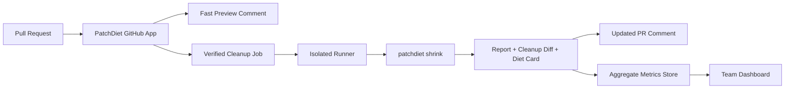

# Free And Hosted Pro Boundary

PatchDiet should remain useful as an open-source local tool. Hosted Pro should add team coordination and history, not remove the local-first workflow.

## Free / Open Source

- CLI cleanup: `patchdiet check`, `patchdiet shrink`, `patchdiet report`, `patchdiet card`
- GitHub Action
- GitHub App fast-preview comments
- VS Code local preview extension
- local-only safety mode
- local reports and Diet Cards
- example datasets and docs

## Hosted Pro

- one-click GitHub App installation with managed runners
- team dashboard
- historical PR shrink trends
- cross-PR noise statistics
- reviewer time saved by repo/team
- badge hosting
- Slack/Linear/Jira summaries
- policy controls for LLM-assisted ranking
- organization-wide ignore rules

## Boundary Rules

- The default local engine stays open-source.
- No hosted feature should require uploading source for local CLI use.
- Pro may store aggregate metrics, but raw diffs should be opt-in and retention-limited.
- LLM-assisted mode must be explicit and auditable.

## Architecture Sketch

