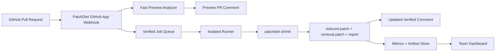

# PatchDiet 大众化可交付产品优化方案

> 审计日期：2026-05-25  
> 目标：把 PatchDiet 从当前的本地可运行产品雏形，升级为可以面向 GitHub 大众市场公开交付、安装、使用、信任、传播和持续付费的产品。  
> 范围：这不是 MVP 清单，而是可交付 v1 产品标准。文档中的 P0 是发布前必须满足的硬门槛，P1 是增强竞争力的第一轮迭代，P2 是商业化和规模化能力。

## 一句话结论

PatchDiet 不应该去和 CodeRabbit、GitHub Copilot Code Review、Qodo PR-Agent 正面竞争“AI 代码审查”。GitHub 市场里的 AI reviewer 已经非常拥挤。PatchDiet 最强的位置应该是：**AI 写完代码并且测试通过之后，自动把 PR 变小、生成可审计 cleanup patch、减少人类 reviewer 真正要看的 diff 面积**。

也就是说，PatchDiet 的核心卖点不是“我帮你发现 bug”，而是：

- 你的 AI agent 写了太多不相关改动。
- 测试已经通过，但 PR 太大，人不想审。
- PatchDiet 用本地 git worktree 和你的验证命令，尝试移除噪音。
- 只有检查仍然通过的候选改动才进入 cleanup 结果。
- 结果是可下载、可审计、可回滚、可复现的更小补丁。

这个定位和现有 GitHub 工具形成差异：AI reviewer 评论代码，linter 报告规则问题，stacked PR 工具帮助组织分支，PatchDiet 则负责**缩小已经生成的 PR**。

## 当前项目现状

基于本地仓库审计，PatchDiet 已经有明显的产品基础，不是空白项目。

### 已有能力

- CLI：`patchdiet init`、`doctor`、`check`、`shrink`、`report`、`card`。
- 核心引擎：解析 unified diff，按文件和 hunk 生成候选项，在临时 worktree 中反向应用候选项并运行验证命令。
- 安全默认值：本地优先、默认不上传源码、不默认重写当前分支、测试通过才移除。
- 报告：Markdown、HTML、GitHub comment、JSON、Diet Card。
- GitHub Action：已有 `action.yml` 和 bundle 后的 Action 入口。
- GitHub App：已有本地 webhook server、JWT、installation token、PR diff 获取、comment upsert 的骨架。
- VS Code 扩展：已有 sidebar、diff preview、candidate 打开和 dry-run JSON 命令。
- Demo：已有本地 30 秒 diff demo、样例 diff、PR URL fetcher。
- 文档：已有 quickstart、config、safety、GitHub Action、GitHub App、VS Code、Pro mode、launch materials、roadmap 等。
- 测试：已有 unit/e2e 测试，覆盖 CLI、Action、demo、GitHub App、VS Code 扩展、release readiness 等。

### 主要短板

这些短板不是“小优化”，而是是否能公开交付的分界线。

| 模块 | 当前状态 | 产品化缺口 |
| --- | --- | --- |
| 分发 | npm metadata 和 workflow 已有 | 需要真实发布、安装验证、版本策略、包体检查、provenance、回滚流程 |
| GitHub App | 本地 skeleton 可跑 | 缺生产 hosting、队列、runner、状态检查、重试、日志、租户隔离、真实安装流程 |
| shrink 引擎 | hunk/file 级保守验证可用 | 需要 patch 语义澄清、rename/binary/generated/lockfile/monorepo/AST 支持、缓存、性能预算 |
| 报告 UX | 基础报告可读 | 需要 reviewer 级别的行动按钮、风险分层、可复制命令、cleanup patch 预览、失败解释 |
| IDE | VS Code scaffold | 需要 VSIX 打包发布、设置 UI、内置 binary 或自动下载、真实 apply/rollback 流程 |
| Demo/官网 | 本地 demo 和素材 | 需要公开站点、真实案例、可复现实验、隐私说明、转化路径 |
| 可信度 | 有安全文案 | 需要 threat model、权限矩阵、数据保留策略、审计日志、第三方依赖和供应链检查 |
| 商业化 | 有 Pro 边界文档 | 需要 pricing、账号、团队、配额、计费、支持、SLA、隐私条款 |

## GitHub 市场判断

### 竞品和替代品

| 类别 | 代表工具 | 市场事实 | 对 PatchDiet 的启发 |
| --- | --- | --- | --- |
| AI PR reviewer | GitHub Copilot Code Review | GitHub 官方文档显示 Copilot 可以审查 PR、给出建议、支持自动 review，并且从 2026-06-01 起 code review runs 会消耗 GitHub Actions minutes | 不要把 PatchDiet 做成另一个 reviewer。要做 reviewer 之后的 diff 缩减层 |
| AI PR reviewer | CodeRabbit | 官网定位是 AI-first pull request reviewer，强调 context-aware feedback、line-by-line suggestions、real-time chat | CodeRabbit 占据“智能评论和修复建议”。PatchDiet 要强调“生成可验证 cleanup patch” |
| AI PR reviewer | Qodo PR-Agent | README 称其为 open-source PR reviewer，Qodo 提供面向 GitHub/GitLab/Bitbucket/Azure DevOps 的 AI code review 平台 | 开源 AI reviewer 已有认知基础。PatchDiet 应避开泛审查，切入 PR 噪音清理 |
| Lint 评论器 | reviewdog | README 表示它把 linter 输出自动发到 code hosting review comments，并能按 diff 过滤 | reviewdog 证明“把机器判断放进 PR review”是成熟需求。PatchDiet 要提供 cleanup artifact，而不只是评论 |
| PR 规范工具 | Danger JS | README 定位为 formalize pull request etiquette，CI 后自动化团队 code review 规范 | 团队愿意把重复审查规则自动化。PatchDiet 的规则要可配置、可解释 |
| 多语言 lint 套件 | Super-Linter | README 表示它是 ready-to-run collection of linters/code analyzers，并强调广泛使用、并行运行、Actions 集成 | 用户期待开箱即用、覆盖多语言、速度快。PatchDiet 的安装和性能不能只停留在 demo |

### 市场空位

GitHub 市场里有大量工具帮人“看 PR”：

- AI reviewer 负责评论 bug、风格、风险。
- linter 负责找格式和规则问题。
- CI 负责证明测试能跑。
- stacked PR 工具负责把开发流程拆小。

但 AI coding agent 带来的新问题是：**代码已经写出来了，测试也过了，但 PR 里面混进了不必要的文件、文档、生成物、实验代码、格式化噪音和范围蔓延**。这些东西不一定是 bug，所以 reviewer 工具未必会删除；linter 也不会认为它们错；CI 只会说它们没有破坏测试。

PatchDiet 的机会是把这个问题产品化：

> “PR 已经存在，能不能在进入人类 review 之前，把它自动瘦身成更小、仍然通过检查、能解释每个移除原因的 patch？”

这比“AI 帮你 review”更窄，但也更锋利。GitHub 市场上，窄而可信的开发者工具更容易形成口碑。

## 产品定位

### 核心定位

PatchDiet 是 **AI-generated PR cleanup layer**。

它运行在这些工具之后：

- Claude Code
- Codex
- Cursor
- OpenHands
- Devin-like agents
- Aider
- GitHub Copilot coding agent
- 人类开发者的大范围修改

它运行在这些流程之前：

- 人类 reviewer 开始认真审查
- PR 被拆分或合并
- release branch 接受改动
- 团队做 code review metrics

### 目标用户

| 用户 | 痛点 | PatchDiet 应提供的价值 |
| --- | --- | --- |
| 独立开源维护者 | AI 贡献 PR 很大，审查时间有限 | 自动标出可移除噪音，减少维护者要看的行数 |
| 小团队技术负责人 | 团队大量使用 Cursor/Codex，PR 质量不稳定 | 在 CI 中自动给出 cleanup patch 和风险分类 |
| 平台/基础设施团队 | monorepo PR 大，测试慢，review 容易拖延 | 缓存、并行、路径策略、团队级趋势报告 |
| AI agent 用户 | agent 做完功能后夹带 docs/generated/scratch 文件 | 本地运行 `patchdiet shrink`，在提交前清理 |
| 安全敏感团队 | 不愿上传源码给外部 AI reviewer | 本地优先、无 LLM、可审计命令和 artifact |

### 不应进入的定位

这些方向会稀释 PatchDiet：

- 不要做泛 AI bug reviewer。
- 不要默认自动改用户分支。
- 不要把“上传源码到 LLM”作为默认路径。
- 不要只做漂亮 dashboard 而忽略 cleanup patch 的正确性。
- 不要把核心卖点写成“节省时间”而不证明如何节省。

## 可交付 v1 的产品标准

公开交付不是“仓库能跑”，而是用户从陌生到成功的完整闭环。

### 用户成功路径

PatchDiet v1 必须支持 4 条完整路径：

1. **30 秒公开 Demo**
   - 用户不安装任何东西。
   - 能加载真实样例 diff。
   - 能粘贴自己的 diff。
   - 能看到 before/after 文件数、hunk 数、行数、候选删除项、风险提示。
   - 明确说明 demo 是 heuristic preview，不是 test-verified cleanup。

2. **3 分钟 GitHub Action**
   - 用户复制一段 YAML。
   - PR 中出现 PatchDiet comment。
   - CI artifacts 包含 report、run.json、cleanup patch。
   - fork PR、权限不足、无测试命令时有清楚降级说明。

3. **5 分钟本地 CLI**
   - 发布前 judge proof：`node dist/packages/cli/src/index.js doctor`
   - 发布前 judge proof：`node dist/packages/cli/src/index.js shrink --test "npm test"`
   - 发布后再使用 `npm exec -- patchdiet ...`，前提是 npm registry 和干净项目已验证。
   - 生成 `.patchdiet/report.html` 和 cleanup artifact。
   - 提供可复制的 apply/branch 命令。

4. **1 分钟 GitHub App 安装**
   - 用户从 GitHub Marketplace 安装 App（外部 listing 提交并 install-tested 后；发布前只作为 draft/listing package 展示）。
   - App 对 PR 先发 preview comment。
   - 如果启用 verified runner，再更新成测试验证结果。
   - App 权限足够少，且权限解释清楚。

### 发布前 P0 硬门槛

| 领域 | P0 要求 | 验收标准 |
| --- | --- | --- |
| npm | 真实发布 npm 包 | `npm view patchdiet version` 能查到当前版本，`npm exec -- patchdiet doctor` 能运行 |
| Action | Marketplace 可用 | 外部仓库使用 `uses: chenfei462/PatchDiet@vX.Y.Z` 成功生成 artifact/comment |
| CLI | 跨平台 | Windows、macOS、Linux CI 都跑过核心 e2e |
| Patch 语义 | cleanup artifact 无歧义 | 明确区分 `reduced.patch` 和 `removal.patch`，`--apply` 在当前 head 上行为正确 |
| 安全 | 不上传源码默认成立 | 自动化测试验证默认路径无网络调用；文档说明可选上传模式尚未启用 |
| 失败体验 | 错误可行动 | base/head/test/permission/fork/timeout/dirty worktree 都给出下一步命令 |
| GitHub App | 生产可安装 | 有真实 GitHub App、生产 webhook、health check、日志、队列、runner 或明确 preview-only |
| 文档 | 新用户能自助 | quickstart、Action、App、CLI、config、troubleshooting、FAQ、安全说明完整 |
| 案例 | 不使用虚假数据 | 至少 3 个可复现实例，包含输入 diff、命令、输出报告、实际缩减结果 |
| 测试 | 发布可信 | unit/e2e/fixtures/release readiness/performance smoke 全部纳入 CI |

## 核心引擎优化

### 1. Patch artifact 语义必须拆清楚

当前产品文案里多次出现 `cleanup.diff`，但用户可能会有两种完全不同的理解：

- 从 base 分支应用，得到瘦身后的最终 PR。
- 从当前 head 分支应用，删除噪音改动。

这两个 patch 方向相反，不能混用。v1 必须显式拆分：

| Artifact | 含义 | 应用位置 |
| --- | --- | --- |
| `.patchdiet/reduced.patch` | base 到瘦身后结果的最终 diff | 应用于 base 或 cleanup branch |
| `.patchdiet/removal.patch` | 当前 head 到瘦身后结果的反向清理 diff | 应用于当前 PR branch |
| `.patchdiet/candidates.json` | 每个候选项的 verdict、reason、commands、duration | 给 CLI、App、IDE、dashboard 使用 |
| `.patchdiet/report.html` | 人类审查报告 | 浏览器打开 |
| `.patchdiet/report.github.md` | GitHub comment body | PR comment |

验收标准：

- `patchdiet shrink --create-branch` 从 base 创建 cleanup branch，并应用 `reduced.patch`。
- `patchdiet shrink --apply-removals` 在当前 head 上应用 `removal.patch`。
- `--apply` 如果保留，必须打印确认提示或改名，避免误解。
- e2e 覆盖 base branch 和 head branch 两种 apply 场景。

### 2. 候选项粒度从 hunk 扩展到语义单元

只靠 hunk/file 粒度会遇到两个问题：太粗会误删相关代码，太细会让测试运行次数爆炸。v1 应支持分层候选：

| 粒度 | 适用对象 | 实现建议 |
| --- | --- | --- |
| file | docs、generated、snapshots、scratch 文件 | 保留当前逻辑，增强分类 |
| hunk | 普通文本 diff | 保留当前逻辑 |
| symbol | TypeScript/Python 函数、类、导出变量 | 用 Tree-sitter 或语言 parser 提取 AST 范围 |
| import/dependency | 未使用 import、package dependency | 结合 package manager 和静态分析 |
| generated group | dist/build/snapshot 同组文件 | 批量验证，失败后 bisect |
| test file | 新增或修改测试 | 默认保留，只在显式配置下评估 |

P0 不一定要支持所有语言 AST，但至少应完成：

- TypeScript/JavaScript symbol-level candidate。
- Python function/class candidate。
- docs/generated/snapshot/lockfile 分类增强。
- rename/copy/delete diff 的正确解析和安全处理。

### 3. 风险分级

用户不会只看 removed/kept，他们会问“为什么可信”。每个候选项应有 risk level。

| 风险 | 条件 | 默认动作 |
| --- | --- | --- |
| Low | docs-only、generated-like、format-only，且验证通过 | 可移除 |
| Medium | unused helper、debug code、dead branch，验证通过但依赖静态分析 | 建议移除，要求人工确认 |
| High | test file、lockfile、public API、migration、schema、security config | 默认保留或 needs-human-review |
| Blocked | reverse apply 失败、binary、submodule、large file、权限失败 | needs-human-review |

报告里要展示：

- candidate path
- hunk/symbol 范围
- category
- risk level
- verification command
- duration
- baseline commit
- worktree id
- reason
- how to reproduce

### 4. 验证系统增强

当前验证是“反向应用候选项，然后运行 required commands”。产品化需要更稳。

P0：

- baseline 先跑，并把 stdout/stderr summary 存入 run.json。
- 每个 candidate 的 test output 只保留摘要，完整日志可选落盘。
- 支持多个 required commands，并在报告中逐项展示。
- 支持 timeout、retry、flaky test 标记。
- 支持命令失败时区分 test failure、timeout、spawn failure、missing dependency。
- 支持 `--max-runtime-minutes` 全局预算，超过后停止生成新候选并报告 partial result。

P1：

- test-result cache：按 `(headSha, candidatePatchSha, command, envHash)` 缓存。
- docs/generated batch 失败后用 bisect，而不是直接退回逐项。
- monorepo path 到 test command 映射，例如：

```yaml
commands:
  required:
    - npm test
test_selection:
  packages:
    "packages/core/**": "npm test -- packages/core"
    "packages/report/**": "npm test -- packages/report"
```

P2：

- 基于 coverage 或 dependency graph 选择测试。
- 与 Nx/Turborepo/Bazel/Pants 集成。
- remote cache 和 hosted runner cache。

### 5. Diff parser 和 Git 边界

产品化必须覆盖真实 Git diff 场景：

- renamed files
- deleted files
- new files
- mode changes
- symlinks
- submodules
- binary files
- large files
- CRLF/LF
- file paths with spaces
- unicode paths
- merge commits
- shallow checkout
- sparse checkout
- monorepo nested git repo

验收标准：

- 每类场景至少一个 fixture。
- parser property test：parse 后 summarize 不丢行数。
- 对无法安全处理的类型明确进入 `needs-human-review`。

## GitHub App 产品化

GitHub App 是大众市场最关键路径。很多用户不会先装 CLI，他们会先点 Marketplace。

### App 模式

v1 应提供两个模式：

| 模式 | 速度 | 是否运行测试 | 数据处理 | 用途 |
| --- | --- | --- | --- | --- |
| Preview | 10 秒内 | 否 | 只读 PR diff | 快速展示候选噪音和缩减潜力 |
| Verified | 取决于测试 | 是 | checkout repo 到隔离 runner | 生成 test-verified cleanup artifact |

Preview 不能冒充 verified。所有 comment 必须清楚标识：

- Preview：heuristic only, not test-verified。
- Verified：checks passed after reverting candidates。

### 生产架构



### App P0 功能

- GitHub Marketplace listing。
- App manifest 和权限解释页。
- webhook signature verification。
- idempotency key：`installation_id/repo_id/pull_number/head_sha`。
- queue：避免 webhook 直接跑长任务。
- runner：每个 job 独立工作目录，结束后清理。
- comment upsert：同一 PR 只维护一个 PatchDiet comment。
- check run：Preview/Verified 各自状态。
- artifact upload：report、run.json、patch。
- fork PR 降级：不使用 secrets 时只做 preview。
- rate limit 处理：GitHub API 限流时重试并报告。
- observability：job id、duration、exit code、candidate count、error type。

### PR Comment UX

PR comment 不要太长。结构建议：

1. 顶部 summary：
   - `PatchDiet verified cleanup`
   - before/after 文件、hunk、行数
   - removed/kept/needs-review 数量
   - test command 和结果

2. 行动按钮或链接：
   - Download `removal.patch`
   - Download `reduced.patch`
   - Open full HTML report
   - Copy local apply command

3. 折叠详情：
   - Top 5 removed candidates
   - Top 5 needs human review
   - Safety disclaimer

4. 失败时：
   - 明确失败原因
   - 提供下一步：设置 test command、提高 timeout、检查 permissions、打开 CLI 本地跑

### GitHub App 可信度

App 安装页面必须解释权限：

| 权限 | 原因 |
| --- | --- |
| Metadata read | GitHub App 基础权限 |
| Contents read | 获取 diff 或 checkout repo |
| Pull requests read | 获取 PR metadata |
| Issues write | 写 PR comment，因为 PR comment 走 issues API |
| Checks write | 发布 PatchDiet preview/verified 状态 |

如果未来要自动推 cleanup branch，需要新增 contents write。v1 建议默认不要申请，避免降低安装转化率。

## CLI 产品化

CLI 是信任基础，也是 GitHub App runner 的核心。

### 安装体验

P0：

```bash
node dist/packages/cli/src/index.js doctor
node dist/packages/cli/src/index.js check
node dist/packages/cli/src/index.js shrink --test "npm test"
```

同时支持：

```bash
npm install -D patchdiet
npx patchdiet doctor
```

文档里不要再把本地 tarball 作为主路径。tarball 只能放在 maintainer/release 文档。

### `doctor` 必须更像产品

当前 `doctor` 已检查 git、repo、base/head、test、worktree、`.patchdiet` 可写。还应增加：

- Node version。
- package manager detection。
- git fetch depth。
- base/head commit SHA。
- required commands 是否真的可执行。
- worktree 支持是否可用。
- GitHub Actions 环境变量识别。
- config schema validation。
- `.patchdiet` 是否被 gitignore。
- 是否存在大文件或 binary diff。
- 是否检测到 monorepo。

输出示例：

```text
PatchDiet doctor

Repository: ok
Base: origin/main -> a1b2c3d
Head: HEAD -> e4f5g6h
Test command: npm test
Baseline test: passed in 38.2s
Worktree support: ok
Artifacts: .patchdiet writable and gitignored
Risk hints: 2 generated files, 1 docs-only file, 0 binary files

Next: patchdiet shrink --test "npm test"
```

### CLI 命令调整

建议命令：

```bash
patchdiet init
patchdiet doctor
patchdiet preview
patchdiet shrink
patchdiet apply-removals
patchdiet create-cleanup-branch
patchdiet report
patchdiet card
patchdiet benchmark
```

其中：

- `preview`：只做启发式分析，不跑测试，用于快反馈。
- `shrink`：生成 verified artifacts，不修改当前分支。
- `apply-removals`：把 `removal.patch` 应用于当前分支。
- `create-cleanup-branch`：从 base 创建瘦身 branch。
- `benchmark`：跑标准 fixture，给用户或维护者复现产品效果。

### JSON schema 稳定

`.patchdiet/run.json` 应有版本号：

```json
{
  "schemaVersion": "1.0",
  "runId": "2026-05-25T12-00-00Z-headsha",
  "mode": "verified",
  "baseSha": "...",
  "headSha": "...",
  "artifacts": {
    "reducedPatch": ".patchdiet/reduced.patch",
    "removalPatch": ".patchdiet/removal.patch",
    "htmlReport": ".patchdiet/report.html"
  }
}
```

这会让 GitHub App、VS Code extension、dashboard、third-party integrations 都能稳定消费。

## VS Code 扩展产品化

当前 VS Code 扩展是 scaffold。要成为产品，必须完成从“看建议”到“安全应用”的闭环。

### P0 能力

- 发布到 Visual Studio Marketplace 和 Open VSX。
- 打包 extension，验证 `.vsix` 安装。
- 如果本地没有 `patchdiet` binary：
  - 提示安装命令。
  - 或自动使用 workspace 的 devDependency。
  - 或扩展内置 platform binary。
- Tree view 展示 candidates：
  - file
  - category
  - risk
  - verdict
  - reason
- Webview 展示 before/after summary。
- 点击 candidate 打开对应文件和 hunk 范围。
- 支持运行 preview。
- 支持运行 verified dry-run。
- 支持复制 apply command。
- 支持打开 `.patchdiet/report.html`。

### P1 能力

- Candidate 勾选和 apply selected removals。
- 与 Source Control view 集成。
- 一键创建 cleanup branch。
- 显示测试输出摘要。
- 多 workspace 支持。
- 支持 Cursor/Windsurf/VS Code forks 的兼容性说明。

## Web Demo 和官网

大众产品必须让用户无需安装就懂。

### 首页首屏

首屏必须回答：

- 它是什么：AI-generated PR cleanup layer。
- 它解决什么：AI 写得太多，reviewer 只想看真正需要的 diff。
- 它怎么可信：local-first, no LLM required, test-verified removals。
- 它如何开始：Try demo、Install GitHub App、Run CLI。

不要把首页做成抽象营销页。第一屏应直接展示真实 PR before/after。

### Demo

P0：

- 公开 URL。
- Reset sample。
- Paste diff。
- Public PR URL fetcher。
- before/after metrics。
- candidate list。
- Diet Card preview。
- 明确 preview disclaimer。
- 不存储用户粘贴的 diff，除非用户显式选择分享。

P1：

- 多语言样例：TypeScript、Python、Go、Rust。
- AI-agent 场景样例：docs noise、generated files、unused helper、scope creep。
- “Run this locally” 自动生成命令。
- 可下载 demo report。

### 案例

发布前必须有真实可复现案例，不能用虚假数据。

每个案例包括：

- 仓库链接或最小复现 repo。
- base/head SHA。
- 原始 diff。
- 测试命令。
- PatchDiet 命令。
- 输出 report。
- removed/kept/needs-human-review 明细。
- 截图或 Diet Card。
- 限制说明。

建议至少 3 个：

1. TypeScript agent PR：移除 docs/generated/unused helper。
2. Python agent refactor：保留功能和测试，移除 scratch notes。
3. Monorepo PR：展示路径策略和性能预算。

## 安全和信任

PatchDiet 的竞争优势之一是“无上传、无 LLM、测试验证”。这个优势必须做实。

### P0 安全文档

新增或扩展这些文档：

- `docs/security-model.md`
- `docs/threat-model.md`
- `docs/github-app-permissions.md`
- `docs/data-retention.md`
- `docs/self-hosting.md`
- `docs/llm-assisted-mode.md`

必须说明：

- 默认是否上传源码：否。
- 默认是否调用 LLM：否。
- GitHub App preview 会读取什么：PR diff 和 metadata。
- Verified runner 会 checkout 什么：用户 repo 的 PR branch。
- artifacts 保存多久。
- logs 是否包含源码片段。
- 如何关闭 hosted storage。
- 如何 self-host App。
- 如何报告漏洞。

### Threat model

至少覆盖：

- 恶意 PR 修改测试命令。
- fork PR 试图访问 secrets。
- patch 文件路径穿越。
- symlink 写出工作区。
- binary/submodule 误处理。
- LLM prompt injection，如果未来启用 LLM。
- GitHub webhook replay。
- installation token 泄露。
- runner workspace 残留。
- report HTML 注入。

### 供应链

P0：

- npm trusted publishing。
- provenance。
- lockfile committed。
- CI 中跑 `npm audit --audit-level=high` 或等效策略。
- GitHub Action bundle freshness check 已有，应保留。
- release tag 和 npm version 一致。
- dependency update policy。

P1：

- OpenSSF Scorecard。
- SBOM。
- signed release artifacts。
- container image for hosted runner。

## 报告和 UI 体验

报告不是附属品，而是 reviewer 是否信任 PatchDiet 的核心。

### Report 信息架构

HTML report 建议结构：

1. Run summary
   - mode: preview/verified
   - base/head SHA
   - duration
   - test commands
   - cache hit rate

2. Before/After
   - files
   - hunks
   - changed lines
   - estimated review minutes

3. Removed
   - 按 risk/category 分组
   - 每项展示验证证据

4. Kept
   - 为什么不能移除
   - 哪个命令失败

5. Needs human review
   - binary、test files、lockfiles、public API、reverse apply failed

6. Artifacts
   - reduced.patch
   - removal.patch
   - run.json

7. Reproduce
   - 完整命令
   - base/head SHA

8. Safety note
   - 不证明语义等价，只证明通过配置检查

### GitHub comment 文案

要减少噪音，GitHub comment 不能本身成为噪音。

推荐 comment 控制在 30 行以内，详情放折叠区或 HTML artifact。

### Diet Card

Diet Card 是传播资产，不是核心验证证据。它应显示：

- Project/repo
- PR number
- before/after changed lines
- reduction percentage
- verified or preview badge
- safety phrase
- link to report

不要在 preview 模式中使用容易误导的“cleaned”字样，应使用“potential cleanup”。

## 性能和规模化

PatchDiet 的核心风险是慢。因为每个候选项都可能跑测试。

### P0 性能目标

| 场景 | 目标 |
| --- | --- |
| Preview demo | 1 秒内完成普通 diff 分析 |
| CLI preview | 3 秒内完成 1,000 行 diff 启发式分析 |
| Verified shrink 小 PR | 不超过 baseline test 时间的 5 倍 |
| Verified shrink 中 PR | 有全局预算，超时返回 partial result |
| GitHub App preview comment | 10 秒内 |
| GitHub App verified comment | 根据测试时间异步更新，不阻塞 webhook |

### P1 性能优化

- worktree pool。
- git worktree mutation 串行，测试执行并行。
- candidate patch hash cache。
- baseline command cache。
- docs/generated batch verification。
- failed batch bisect。
- path-based test selection。
- max candidates per run。
- max changed lines per run。
- skip huge binary/generated files by policy。

### P2 性能优化

- remote runner warm pool。
- repo dependency cache。
- package manager cache。
- per-team performance budgets。
- historical candidate ranking。

## 配置系统

`patchdiet.yaml` 应变成产品级配置，而不是内部参数集合。

建议 schema：

```yaml
version: 1

base: origin/main

commands:
  required:
    - npm test
  optional:
    - npm run lint

safety:
  mode: local
  allow_upload: false
  allow_branch_write: false
  allow_test_file_removal: false

scope:
  ignore_paths:
    - "vendor/**"
    - "fixtures/**"
  protected_paths:
    - "migrations/**"
    - "security/**"
    - "package-lock.json"

classification:
  generated_paths:
    - "dist/**"
    - "**/*.generated.ts"
  docs_paths:
    - "docs/**"
    - "*.md"

verification:
  timeout_ms: 120000
  retry_flaky_tests: 1
  max_runtime_minutes: 20
  max_candidates: 80

performance:
  max_parallel_worktrees: 4
  cache_tests: true

report:
  html: true
  markdown: true
  github_comment: true
```

P0 要求：

- config schema validation。
- unknown keys 给 warning。
- invalid values 给 actionable error。
- `patchdiet init --preset node|python|go|rust|monorepo`。
- 文档中每个字段都有说明和默认值。

## 商业化和 hosted Pro

开源版必须有独立价值。Hosted Pro 不能把核心 cleanup 功能锁死。

### 免费/开源版

- CLI。
- GitHub Action。
- GitHub App preview。
- 本地 verified shrink。
- VS Code local preview。
- local reports。
- Diet Card。
- example fixtures。

### Hosted Pro

- managed GitHub App verified runner。
- team dashboard。
- PR shrink history。
- reviewer time saved trends。
- noisy path/agent statistics。
- org-level config。
- Slack/Linear/Jira summaries。
- badge hosting。
- audit logs。
- SSO/SAML。
- self-hosted runner support。
- optional LLM-assisted candidate ranking with explicit opt-in。

### Pricing 建议

不要按“AI review comments”定价，因为 PatchDiet 不是 reviewer。

更适合：

- Free：public repos + local CLI + limited preview。
- Team：private repos、managed verified runs、history、badges。
- Business：org policies、audit logs、SSO、self-hosted runner、retention controls。

关键计费单位：

- verified PR runs/month。
- private repos。
- retained history。
- runner minutes。

## 文档和支持

### 必备文档

| 文档 | 内容 |
| --- | --- |
| README | 一屏讲清产品、30 秒 demo、CLI、App、Action、安全合同 |
| Quickstart | 3 条路径：CLI、Action、App |
| Troubleshooting | base/head、test、permissions、fork、timeout、worktree、Windows |
| Config reference | 每个字段、默认值、示例 |
| Safety model | 不上传、不 LLM、不语义等价证明 |
| GitHub App | 权限、安装、模式、失败降级 |
| Action | YAML、inputs、artifacts、permissions |
| CLI reference | 命令、flags、exit codes |
| VS Code | 安装、设置、运行 preview/verified |
| Examples | 可复现实例 |
| Benchmarks | fixture schema、指标、结果 |
| Pro mode | 免费和付费边界 |
| Release | 版本、发布、回滚 |

### Support 机制

P0：

- issue templates：bug、false positive、performance、docs、feature request。
- discussions 或 Discord/GitHub Discussions。
- SECURITY.md 已有，应补充 hosted App 报告路径。
- public roadmap。
- changelog。

P1：

- telemetry opt-in。
- support email。
- status page for hosted App。

## 增长和 GitHub 市场上线

### GitHub Marketplace

必须准备：

- App logo。
- 3 张截图：
  - PR comment before/after。
  - HTML report。
  - Diet Card。
- 60 秒 GIF。
- 权限解释。
- pricing link。
- privacy policy。
- support link。
- terms link。

### README 增长优化

首屏建议顺序：

1. Tagline: Verified cleanup for AI-generated PRs.
2. Before/after real numbers。
3. Demo button/link。
4. Install GitHub App。
5. CLI command。
6. Safety contract。
7. Real case studies。

不要把状态写成“still needs to publish”放在主 README 首屏附近。发布后应改为：

```text
npm exec -- patchdiet doctor
```

维护者发布说明移到 `docs/release.md`。

### Launch 素材

P0：

- Hacker News 文案。
- Reddit 文案。
- X/LinkedIn thread。
- Demo GIF。
- 3 个案例。
- 1 个技术 blog：为什么测试通过的 AI PR 仍然很难 review。
- 1 个安全 blog：为什么 PatchDiet 默认不上传源码。

### 社区传播点

PatchDiet 容易传播的内容不是“又一个 AI 工具”，而是具体数字：

- “4 files / 128 changed lines -> 2 files / 32 changed lines” verified on agent-large-pr with node --test passing
- Browser preview sample: “5 files / 33 lines -> 2 files / 14 lines”, 58% review noise removed, 4m estimated attention saved
- “Browser previews likely noise; CLI verifies removals by rerunning tests.”
- “reviewer only sees the patch that still matters”
- “No source upload, no LLM required”
- “Cleanup patch verified by your own tests”

## 质量门槛

### 测试矩阵

P0 fixture：

| Fixture | 必须验证 |
| --- | --- |
| docs-only noise | 移除 docs hunk 后测试仍通过 |
| generated artifact | 移除 generated file 后测试仍通过 |
| behavior-bearing code | 不能移除 |
| changed test file | 默认保留 |
| binary file | needs-human-review |
| reverse apply conflict | needs-human-review |
| rename file | 正确处理或 needs-human-review |
| lockfile change | 默认高风险 |
| monorepo package | 路径策略生效 |
| flaky test | retry 和标记生效 |
| timeout | 可读错误和 partial result |
| Windows path | 不因路径分隔符失败 |

### CI

P0：

- build。
- typecheck。
- unit tests。
- e2e tests。
- release readiness。
- action bundle freshness。
- Windows/macOS/Linux matrix。
- npm pack install smoke。
- VSIX package smoke。
- GitHub App webhook smoke。

### 发布流程

P0：

1. update version。
2. update changelog。
3. run full CI。
4. run `npm pack` and install smoke。
5. tag release。
6. GitHub release notes。
7. npm publish with provenance。
8. verify `npm exec -- patchdiet --help`。
9. update Action example tag。
10. create post-release issue for monitoring regressions。

## 8 周交付路线

这是直接交付 v1 的路线，不是 MVP。每周都应该产出可验证 artifact。

### 第 1 周：发布阻塞项和 patch 语义

- 拆分 `reduced.patch` 和 `removal.patch`。
- 修正 `--apply` 语义。
- 增加 apply/create-branch e2e。
- 增强 `doctor`。
- 完成 npm pack install smoke。
- 补充 release checklist。

验收：

- 本地和 CI 都能验证 patch 方向正确。
- 新用户能通过 CLI 完成一次 shrink。

### 第 2 周：候选分类和风险分级

- 增强 diff parser。
- 增加 rename/delete/binary/lockfile fixtures。
- 增加 risk level。
- 报告展示 risk、category、reason、command。
- config schema validation。

验收：

- 报告能解释每个候选项。
- 高风险文件默认不会被静默移除。

### 第 3 周：性能和验证稳定性

- test-result cache。
- batch failure bisect。
- 全局 runtime budget。
- candidate limit。
- worktree cleanup hardening。
- partial result 报告。

验收：

- 中等 PR 不会无限跑。
- 超时能返回可用报告。

### 第 4 周：GitHub Action 和 npm 正式发布

- npm trusted publishing 完成。
- Action 使用外部仓库验证。
- PR comment UX 压缩。
- artifacts 完整。
- fork PR 降级测试。
- README 从“待发布”改为正式安装路径。

验收：

- 外部 repo 复制 README 命令可以跑通。

### 第 5 周：GitHub App preview 生产化

- 注册 GitHub App。
- 部署 webhook。
- 实现 queue 和 idempotency。
- App preview comment 10 秒内返回。
- Marketplace listing draft。
- 权限说明。

验收：

- 安装 App 后，真实 PR 收到 preview comment。

### 第 6 周：Verified runner

- runner checkout。
- job isolation。
- artifact storage。
- verified comment update。
- check run status。
- logs 和 metrics。
- failure handling。

验收：

- App 能从 preview 更新到 verified。
- runner 失败不会刷屏或泄露敏感日志。

### 第 7 周：VS Code 和公开 Demo

- VSIX package。
- Marketplace/Open VSX 发布准备。
- Web demo 部署。
- demo 隐私说明。
- 真实案例页面。
- Diet Card polish。

验收：

- 用户能在浏览器、GitHub、VS Code 三个入口理解并尝试产品。

### 第 8 周：Launch readiness

- 3 个案例。
- benchmark 页面。
- launch blog。
- trust/security docs。
- pricing/Pro 页面草案。
- issue templates。
- support/status 页面。
- final release rehearsal。

验收：

- 一个陌生用户可以从 README 或 Marketplace 自助完成首次成功。
- 一个安全敏感团队可以理解默认数据边界。
- 一个维护者可以复现公开案例。

## 成功指标

### 产品指标

| 指标 | v1 目标 |
| --- | --- |
| Demo activation | 访问 demo 后 30 秒内看到 before/after |
| CLI first success | 新用户 5 分钟内生成 report |
| GitHub App preview latency | P50 < 10 秒 |
| Verified run completion | P80 在用户测试预算内完成 |
| Cleanup acceptance | 用户下载或应用 cleanup patch 的比例 |
| False positive rate | 用户标记“错误移除建议”的比例低于 2% |
| Report usefulness | PR comment 获得正反馈或无投诉 |

### 市场指标

| 指标 | v1 目标 |
| --- | --- |
| GitHub stars | launch 后持续增长，而不是单日尖峰 |
| Marketplace installs | 安装到至少一批真实 repo |
| npm downloads | 有非维护者下载 |
| Case study shares | 至少 3 个可复现案例被引用 |
| Issues quality | 用户开始提交真实 false-positive/performance 反馈 |

## 最大风险和应对

| 风险 | 影响 | 应对 |
| --- | --- | --- |
| 用户误以为 PatchDiet 证明语义等价 | 信任风险 | 所有报告明确“不证明语义等价，只证明配置检查通过” |
| cleanup patch 方向混乱 | 数据损坏或使用失败 | 拆分 reduced/removal patch，重命名命令，e2e 覆盖 |
| 测试太慢 | 用户放弃 | preview/verified 分层、缓存、预算、partial result |
| AI reviewer 巨头挤压 | 定位模糊 | 坚持 PR cleanup layer，不做泛 reviewer |
| GitHub App 权限吓退用户 | 安装转化低 | 默认不申请 write contents；自动写分支作为 opt-in |
| 公开案例缺乏真实性 | 市场不信 | 只使用可复现案例，避免假数字 |
| LLM mode 破坏安全叙事 | 核心差异丧失 | LLM-assisted 只做显式 opt-in，默认 local-only |

## 推荐优先级总表

| 优先级 | 事项 | 原因 |
| --- | --- | --- |
| P0 | 拆清 patch artifact 和 apply 语义 | 这是交付安全底线 |
| P0 | npm/Action 真实发布和外部安装验证 | 没有分发就不是大众产品 |
| P0 | GitHub App preview 生产可安装 | GitHub 市场主入口 |
| P0 | 报告 UX 和 risk level | reviewer 信任来自解释 |
| P0 | 真实案例和 benchmark | 市场需要证据 |
| P0 | 安全文档和权限说明 | local-first 是最大差异化之一 |
| P1 | test cache 和 batch bisect | 解决速度瓶颈 |
| P1 | AST/symbol candidate | 提升清理质量 |
| P1 | VS Code 发布 | 抢占本地 agent 用户 |
| P1 | Hosted verified runner | 商业化核心 |
| P2 | 团队 dashboard | Pro 留存 |
| P2 | optional LLM ranking | 只在不破坏信任时增加智能 |

## 最终建议

PatchDiet 要想在当前 GitHub 市场里有竞争力，最重要的是把“可信 cleanup patch”做到极致，而不是追逐更宽的 AI review 功能。

v1 的交付标准应该是：

- 外部用户能安装。
- GitHub PR 里能看到结果。
- 本地 CLI 能复现。
- 报告能解释。
- patch 能安全应用。
- 失败时能知道下一步。
- 安全边界说得清楚。
- 公开案例能验证产品价值。

只要这个闭环成立，PatchDiet 就有机会成为 AI coding 工作流里的固定步骤：agent 写代码，CI 跑测试，PatchDiet 瘦身 PR，人类 reviewer 只看真正值得看的 diff。

## 参考来源

- GitHub Docs: [Using GitHub Copilot code review](https://docs.github.com/en/copilot/using-github-copilot/code-review/using-copilot-code-review)
- CodeRabbit: [AI Code Reviews](https://www.coderabbit.ai/)
- Qodo PR-Agent README: [qodo-ai/pr-agent](https://github.com/qodo-ai/pr-agent)
- reviewdog README: [reviewdog/reviewdog](https://github.com/reviewdog/reviewdog)
- Danger JS README: [danger/danger-js](https://github.com/danger/danger-js)
- Super-Linter README: [super-linter/super-linter](https://github.com/super-linter/super-linter)
- PatchDiet local docs: `README.md`, `docs/productization-status.md`, `docs/roadmap.md`, `docs/performance-and-intelligence.md`, `docs/github-app.md`, `docs/pro-mode.md`
