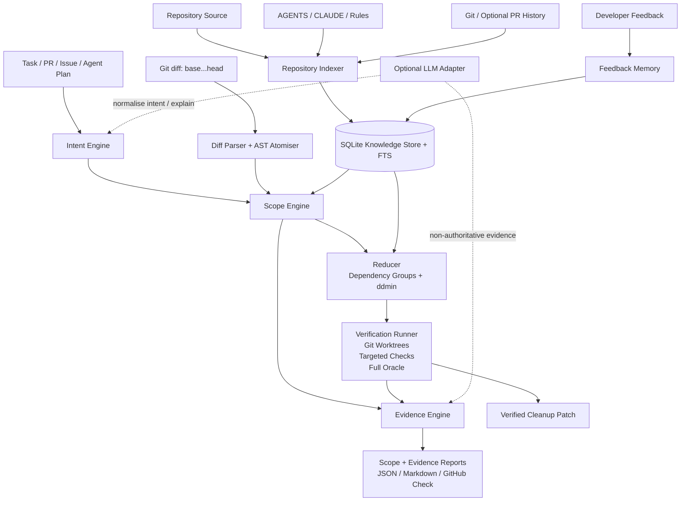

# PatchDiet: AI Change Scope & Verification — Product, Architecture and Delivery Plan

**Research cut-off: 3 October 2026**  
**Recommended release horizon: eight weeks, with a shippable CLI v0.2 at the end of week six and a GitHub App private beta by the end of week eight.**

## Executive summary

PatchDiet should evolve from a **test-driven patch minimiser** into an **independent scope-and-verification gate for AI-generated code**:

> **PatchDiet: AI Change Scope & Verification**  
> **Keep AI-generated changes on scope.**

The market problem is no longer merely that coding agents generate too much code. The more important problem is that developers increasingly have to determine whether an agent changed **only what the task required**, whether unrelated behaviour was disturbed, and whether supposedly unnecessary changes can safely be removed.

The independent evidence for this is stronger than a generic “AI code is bad” thesis. Stack Overflow's 2025 Developer Survey found that 66% of respondents were frustrated by AI answers that were “almost right”, 45% said debugging AI-generated code could be more time-consuming, and distrust of AI-tool accuracy exceeded trust, at 46% versus 33%. The survey covered 49,009 responses across 177 countries, though its Stack Overflow audience introduces sampling limitations. citeturn11search1turn11search17turn11search13 DORA's 2026 analysis similarly reports that faster AI-assisted generation often shifts effort downstream into **auditing and verification**, and that greater AI adoption is associated with higher delivery throughput but also higher delivery instability; this is association rather than proof of causation. citeturn16search1turn16search5

The exact scope-control failure PatchDiet can address is also appearing in live agent products. A May 2026 Claude Code feature request asks for a “strict scope / guardrails mode” because targeted tasks can expand into unrelated refactors, renames, configuration changes and file edits that make review harder. fileciteturn9file0L3-L6 A June 2026 Claude Code bug report describes unrelated changes silently removing existing functionality and says repository specifications plus source-level regression checks helped prevent the damage. fileciteturn10file0L3-L6 An OpenAI Codex issue from February 2026 similarly reports an agent reverting unrelated work made by other agents despite explicit instructions not to do so. fileciteturn11file0L3-L6 These issues are anecdotal, not prevalence estimates, but they are unusually direct evidence of the workflow failure PatchDiet is designed to catch.

At the same time, the AI-review market is converging around richer repository context. Greptile uses repository graphs and is expanding from code review towards runtime code validation; CodeRabbit combines issue intent, code graphs, prior PR context, rules, linters and generated verification scripts; Qodo is building PR-history knowledge and governance; Graphite combines AI review with stacked-PR and merge workflows. citeturn19view0turn19view1turn20view0turn20view2turn17search7turn13search9 That makes **“better RAG code review” a poor differentiation strategy**.

PatchDiet's defensible wedge should instead be:

> **Counterfactual verification:** “What happens if we remove this AI-generated change?”  
> Generate candidates from task intent and repository structure, remove them in an isolated environment, execute the project's verification oracle, and only produce an automatic cleanup after the **combined final patch** passes.

That builds naturally on the current repository. PatchDiet v0.1 already parses a diff into hunks, reverse-applies each hunk in a temporary worktree and reruns required commands. fileciteturn3file0L2-L2 Its README explicitly positions the product as local-first, not an AI reviewer, and says AST atoms and richer dependency reasoning are not yet implemented. fileciteturn2file0L2-L2 The existing roadmap already names TypeScript/Python AST atoms, dependency-aware grouping and stronger cleanup generation for v0.2. fileciteturn23file0L2-L2

Two correctness problems should precede every knowledge feature. First, the current CLI initialises `--test` to `[]`, while configuration merging uses `flags.test ?? config.commands.required`; therefore an omitted CLI test flag can select the empty array instead of tests configured in `patchdiet.yaml`. fileciteturn12file0L2-L2 fileciteturn8file0L2-L2 Second, candidates are tested one hunk at a time, but the set of individually removable hunks is later combined into one output without a final combined verification pass. fileciteturn7file0L2-L2 Both are P0 safety issues.

The recommended v0.2 therefore has four pillars:

| Pillar | Purpose | Rule |
|---|---|---|
| **Scope Map** | Compare task intent with actual diff at file/symbol/atom level | Context may identify suspicious changes, but cannot delete them |
| **Evidence Engine** | Explain why an atom looks necessary, supporting, unrelated or uncertain | Every conclusion exposes evidence rather than a hidden score |
| **Reducer** | AST-aware grouping plus ddmin-style counterfactual reduction | Search for the largest safely removable subset |
| **Verifier** | Targeted checks during search plus mandatory complete final verification | Only executable evidence can promote an automatic cleanup to “verified” |

The v0.2 implementation should remain **local-first and SQLite-based**. It does not need Qdrant, Milvus, a hosted vector database or a bespoke model. Symbol relationships, FTS, task intent, test mappings, repository rules, run evidence and feedback fit comfortably in SQLite for the initial product.

The proposed six-week core MVP requires approximately **65 person-days**; the two-week GitHub App and design-partner extension raises the total to **91 person-days** across the zcode engineer, infra, QA and product roles. These are effort budgets and can overlap; they do not imply four full-time people are required continuously.

The central success criterion is not maximum line reduction. It is:

> **False automatic removal should approach zero.**

The proposed v0.2 release gate is **≥98% precision for high-confidence automatic removals on the labelled benchmark, 100% final-oracle pass rate for artefacts advertised as verified, and zero known hidden regressions in the release benchmark**. Those are product targets, not existing industry benchmarks.

## Market evidence and strategic positioning

The market has moved from “Can AI generate code?” towards “Can teams trust and review the volume of code agents generate?” DORA explicitly describes verification and auditing as downstream work into which AI's generation-time savings can be reallocated. citeturn16search1 Stack Overflow's independent survey shows a related trust gap around almost-correct output and debugging burden. citeturn11search1turn11search17 GitHub itself has published engineering guidance on converting one large AI-generated pull request into a more reviewable change stack, another signal that agent-generated review surface is becoming a workflow problem rather than merely a model-quality problem. citeturn22view1

The direct agent-product reports make the narrower PatchDiet thesis compelling. The Claude Code “strict scope” request explicitly describes a request such as fixing one UI problem expanding into styling structure, shared utilities, configuration files and unrelated components; the author asks for approval before the agent crosses scope boundaries. fileciteturn9file0L3-L6 The other Claude Code report describes whole functions/classes being regenerated around the current task and pre-existing functionality disappearing because it was outside the agent's active context. fileciteturn10file0L3-L6 The Codex report adds the multi-agent case: an agent can regard another agent's legitimate concurrent work as something to “clean up”. fileciteturn11file0L3-L6

That leads to a sharper user problem than “bloated PRs”:

> **I delegated a bounded task to an agent. Show me where the resulting diff exceeds that task, explain why, and prove which excess changes can be removed without breaking the project's configured contract.**

**Recommended positioning**

```text
Coding Agent                    PatchDiet                  Reviewer
────────────                    ─────────                  ────────
Claude Code ─┐
Codex ───────┼─> generated PR ─> Scope Map ─┐
Cursor ──────┤                              ├─> Minimal Verified Diff ─> Human
Devin ───────┘               Evidence Engine│                        └─> AI Reviewer
                               Reducer ──────┤
                               Verifier ─────┘
```

PatchDiet therefore should **not** answer the broad question “Is this good code?”. Greptile, CodeRabbit, Qodo and Graphite already compete aggressively there. PatchDiet should answer the narrower and more experimentally testable question:

> **“Did this task require this change?”**

and, where the answer may be “no”:

> **“Can the change be removed while the project's configured oracle still passes?”**

The commercial and open-source landscape reinforces that choice.

| Project | Current relevant signal | What PatchDiet should learn | Where PatchDiet should differ |
|---|---|---|---|
| [Greptile](https://www.greptile.com/) | Builds a repository graph containing code entities and dependencies, learns from review feedback, and in 2026 is explicitly expanding from review towards code validation and runtime checks. Its Pro plan is currently listed at US$30/seat/month. citeturn19view0turn19view1turn19view2 | Repository graph, repository memory, runtime evidence | Do not become a general reviewer; specialise in *necessity testing and verified removal* |
| [CodeRabbit](https://www.coderabbit.ai/) | Its current Context Engine combines issue intent, code graph, prior PRs, rules, linters/SAST and sandbox verification scripts. It also offers Change Stack for organising large diffs. Annual listed tiers span roughly US$24–72/developer/month. citeturn20view0turn17search1turn20view1 | Intent, graph, rules, logical grouping, verification before surfacing conclusions | PatchDiet should modify/minimise the candidate patch, not merely comment on it |
| [Qodo](https://www.qodo.ai/) | Qodo 2.2 introduced PR-history knowledge that indexes previous PRs, discussions and review decisions; Qodo 3.0, announced on 1 October 2026, broadens this towards enterprise code quality and governance. citeturn20view2turn17search7 | Historical decision memory and policy context | Keep v0.2 repository-local and focused on an executable scope gate |
| [Graphite](https://graphite.com/) | Combines AI reviews with stacked PRs, merge workflow and agent integrations; current annual plans include US$20/user/month Starter and US$40/user/month Team. citeturn13search9turn13search21turn13search23 | Reviewability and developer-native PR UX | Avoid building another end-to-end PR management platform |
| [AgentDiff](https://github.com/natiixnt/AgentDiff) | Groups agent changes logically, annotates risk, supports AST-aware signals and explicitly flags “planned-but-unchanged” and “changed-but-unplanned” drift. fileciteturn15file0L2-L2 | Plan-vs-diff analysis and reviewer-oriented Scope Map | Add counterfactual execution and automatic minimisation |
| [C-Reduce](https://github.com/csmith-project/creduce) | Minimises programs while preserving a user-specified interesting property, evaluating variants in isolated temporary environments. fileciteturn17file0L2-L2 | Treat tests/checks as an explicit reduction oracle | Apply the principle to PR diffs and task scope rather than compiler test cases |
| [Picire](https://github.com/renatahodovan/picire) | Implements delta debugging with subset/complement reduction, parallel evaluation and reduction towards 1-minimal test cases. fileciteturn20file0L2-L2 | ddmin, complement-first search, caching/parallelisation | Search over dependency-aware change groups rather than arbitrary lines |
| [Perses](https://github.com/uw-pluverse/perses) | Uses syntax-directed reduction to avoid generating syntactically invalid programs and stresses deterministic, isolated, time-bounded test oracles. fileciteturn22file0L2-L2 | AST atoms and hardened verification execution | Preserve cross-file PR intent and repository dependencies, not just individual-program syntax |

Vendor feature claims above should be interpreted as **competitive product signals**, not independent proof of efficacy. The independent market evidence remains the Stack Overflow and DORA research, while public agent issues provide qualitative examples of the specific failure mode. citeturn11search1turn16search1

**Primary target customer.** The best initial design partner is a **2–20 developer, or at most roughly 50-developer, GitHub-based TypeScript/Python team** using Claude Code, Codex, Cursor or comparable agents heavily. The especially attractive case is a founder, senior engineer or tech lead who can generate code faster with agents than they can review it. This is a recommended ICP, not a measured market-share claim.

The initial job-to-be-done is:

> “Before I spend human attention reviewing this agent PR, tell me what appears outside the requested task and produce the smallest version that still passes the checks I trust.”

Enterprise quality teams are a logical second segment, but should not drive the first eight weeks because enterprise requirements such as SSO, RBAC, audit retention, security review and bespoke deployment would obscure whether the underlying scope gate is valuable.

**Success metrics should be explicit and experimentally measurable.** The following targets are recommended release/pilot objectives rather than industry benchmarks.

| Metric | Exact definition | v0.2 / pilot target |
|---|---|---:|
| **High-confidence removal precision** | Human-labelled or benchmark-safe automatically removed atoms ÷ all atoms automatically removed as high confidence | **≥98%** on release benchmark |
| **Scope-violation hit rate** | PRs where PatchDiet finds ≥1 confirmed scope violation ÷ labelled PRs known to contain ≥1 violation | **≥80% synthetic/injected benchmark**, report real-world rate separately |
| **Accepted cleanup rate** | Proposed cleanup patches that developers accept/retain ÷ cleanup patches proposed | **≥40%** pilot, ≥60% stretch |
| **Review reduction** | Median reduction in changed semantic atoms, files and LOC for accepted cleanups | **≥25% semantic-atom reduction** on accepted cleanups |
| **Final verification pass rate** | Artefacts advertised as “verified” whose exact final clean patch passes every required check | **100%** |
| **Hidden regression rate** | Known benchmark regressions missed by a supposedly safe automatic cleanup | **0 at release** |
| **Inconclusive/human-review rate** | Candidates deliberately not automated due weak evidence, flakiness or unsupported diff semantics | Track, **do not optimise down at expense of precision** |
| **Verification cost** | Median wall time, command executions and cache hit rate per run | Baseline first; optimise after safety |

The north-star metric should therefore **not** be “lines deleted”. A product that deletes 70% of a diff incorrectly is worse than one that removes 15% with extremely high precision.

## PatchDiet v0.2 product specification

The current product already has the right safety instinct: establish a passing baseline, reverse-apply a candidate in a detached worktree, rerun required commands and classify the hunk from the result. fileciteturn3file0L2-L2 v0.2 should preserve that philosophy while changing the unit of reasoning from “every hunk independently” to **task-aware, dependency-aware change atoms and groups**.

**Scope Map.** Every changed atom should receive one principal scope state:

| State | Meaning | Automation |
|---|---|---|
| `required` | Direct evidence connects the change to a stated task requirement or acceptance criterion | Never prioritise for removal |
| `supporting` | No direct intent match, but graph/test/dependency evidence shows it supports required changes | Normally retain |
| `candidate` | Little or negative scope evidence; plausible unnecessary change | Send to reducer |
| `uncertain` | Evidence conflicts or is too weak | Human review |
| `protected` | Repository policy blocks automatic removal | Human review regardless of score |

Risk flags such as dependency manifest, migration, generated file, security-sensitive path or public API change should be orthogonal to the scope state. That avoids incorrectly equating “risky” with “out of scope”.

**Intent extraction.** v0.2 should resolve intent in deterministic source order:

```text
explicit --task / --task-file
          ↓
structured agent execution plan
          ↓
PR title + PR body
          ↓
linked GitHub issue
          ↓
commit messages
          ↓
optional LLM normalisation
```

The output should be structured rather than a free-form summary:

```json
{
  "goal": "Fix session expiry after refresh-token rotation",
  "requirements": [
    {
      "id": "R1",
      "text": "A rotated refresh token must extend the active session",
      "source": "github_issue#184",
      "source_span": "..."
    }
  ],
  "must_preserve": [],
  "mentioned_paths": [],
  "mentioned_symbols": [],
  "acceptance_criteria": [],
  "constraints": []
}
```

An LLM may convert messy issue prose into this schema, but every extracted requirement should retain a source reference. **An LLM judgement alone must never make an atom automatically removable.**

**Symbol graph.** v0.2 should support TypeScript/JavaScript and Python first, consistent with the existing roadmap's TypeScript/Python AST direction. fileciteturn23file0L2-L2 The graph needs only enough precision for scope reasoning:

```text
file
 ├── contains → symbol
 ├── imports  → file/symbol
 └── test-of  → symbol

symbol
 ├── calls/references → symbol
 ├── exports          → module API
 ├── extends          → symbol
 └── changed-by       → atom
```

Tree-sitter is a practical v0.2 parser layer. The goal is not compiler-grade whole-program soundness. Failed parsing must degrade safely to the existing hunk representation.

**Evidence Engine.** For each atom, evidence should be collected under stable categories rather than collapsed prematurely into one opaque probability:

```text
Intent evidence
Graph evidence
Repository-rule evidence
Test evidence
Historical evidence
Static-change evidence
Runtime verification evidence
Developer-memory evidence
```

The engine may derive an internal ranking score to order candidate evaluation, but user-visible decisions should cite the contributing evidence.

**Repository rules** should automatically discover commonly used agent/project instruction files:

```text
AGENTS.md
CLAUDE.md
GEMINI.md
.github/copilot-instructions.md
CONTRIBUTING.md
```

Rules should also support path-scoped entries from `patchdiet.yaml`. The Claude regression report is particularly relevant here: its author said a CLAUDE.md inventory of required methods/invariants plus source-level regression tests helped stop further destructive rewrites. fileciteturn10file0L3-L6

**Reducer.** v0.2 should expose three reduction levels:

```text
hunk        universal fallback
symbol      changed declaration/function/class/method group
ast         syntax-valid import/declaration/statement atoms
```

The default should become:

```yaml
strategy: ddmin
atom_granularity: ast
dependency_grouping: true
```

Picire's subset/complement strategy provides the algorithmic model, while Perses demonstrates why syntactically valid structural atoms are preferable to arbitrary textual deletion. fileciteturn20file0L2-L2 fileciteturn22file0L2-L2

**Verification has two levels.** Targeted tests may cheaply screen candidates during search, but the final retained patch must run every configured required command. No targeted-test mapping, graph result, historical pattern or LLM conclusion may substitute for the final oracle.

The CLI should make those conceptual layers obvious:

```bash
# Initialise v2 configuration
patchdiet init

# Build/update local repository knowledge
patchdiet index

# Read-only scope analysis
patchdiet verify \
  --base origin/main \
  --head HEAD \
  --task "Fix session expiry after refresh-token rotation"

# Explain classifications and evidence
patchdiet explain \
  --base origin/main \
  --head HEAD

# Generate a verified cleanup
patchdiet shrink \
  --base origin/main \
  --head HEAD \
  --task "Fix session expiry after refresh-token rotation" \
  --test "pnpm test" \
  --test "pnpm typecheck"

# Explicit reduction controls
patchdiet shrink \
  --strategy ddmin \
  --granularity ast \
  --final-verify

# Render machine/human reports
patchdiet report --format json
patchdiet report --format markdown

# Feed a mistaken classification back into repository-local memory
patchdiet feedback \
  --run 01J... \
  --atom atom_17 \
  --decision keep
```

`verify` must be read-only. `shrink` creates the candidate cleanup. `explain` is evidence retrieval. `feedback` records a decision but cannot weaken hard safety rules.

A proposed v2 configuration is:

```yaml
version: 2
base: origin/main

commands:
  required:
    - pnpm test
    - pnpm typecheck
  optional:
    - pnpm lint

intent:
  sources:
    - cli
    - github_pr
    - linked_issue
    - commits
  llm: auto

knowledge:
  database: .patchdiet/knowledge.sqlite
  languages:
    - typescript
    - javascript
    - python

  rules:
    auto_discover:
      - AGENTS.md
      - CLAUDE.md
      - GEMINI.md
      - .github/copilot-instructions.md
      - CONTRIBUTING.md

  history:
    git: true
    merged_prs: false

reduction:
  strategy: ddmin
  atom_granularity: ast
  dependency_grouping: true
  final_verification: true
  retry_flaky_tests: 2
  max_runtime_minutes: 20

verification:
  targeted_first: true
  full_required_at_end: true

safety:
  protect:
    - "**/migrations/**"
    - "**/generated/**"
    - "**/vendor/**"
  dependency_manifests: human-review
  unsupported_diff: human-review

report:
  evidence: true
  json: true
  markdown: true
  github_check: true
```

Unlike the current loader, v2 must actually parse and enforce runtime/retry/reduction settings rather than retaining hard-coded defaults where configuration fields exist. The current `PatchDietConfig` already models maximum runtime and flaky-test retries, but the loader currently assigns defaults to those reduction properties. fileciteturn8file0L2-L2

**Example Scope Report**

```text
PatchDiet Scope Report
======================

Task
  Fix session expiry after refresh-token rotation

Base     origin/main
Head     a7bd163
Changed  14 files | 812 LOC | 22 semantic atoms

Scope
  REQUIRED              6 atoms | 281 LOC
  SUPPORTING             4 atoms |  96 LOC
  REMOVAL CANDIDATES     7 atoms | 336 LOC
  UNCERTAIN              3 atoms |  99 LOC
  PROTECTED              2 atoms

auth/session.ts::rotateToken
  REQUIRED
  + Direct requirement match:
    "refresh-token rotation"
  + Covered by session-rotation integration test

auth/token.ts::decodeToken
  SUPPORTING
  + Dependency path:
    session.rotateToken -> token.decodeToken

utils/date.ts::formatMarketingDate
  REMOVAL CANDIDATE
  - No requirement match
  - No dependency path to task symbols
  - No mapped task test
  - Separate historical subsystem

package.json::date-fns
  UNCERTAIN
  ! Dependency-manifest policy requires human review

Suggested reduction
  7 candidate atoms in 4 dependency groups

Verification
  Not yet executed.
  Run: patchdiet shrink
```

A GitHub App should reuse exactly this data model rather than inventing a separate cloud analysis. GitHub's Checks API supports Markdown summaries, line annotations and up to three requested actions, making it a good fit for actions such as **Explain**, **Generate cleanup** and **Keep**. Writing Check Runs requires a GitHub App. citeturn22view0

The intended App flow is:

```text
PR opened / synchronised
        ↓
PatchDiet GitHub App receives event
        ↓
GitHub Action or customer-controlled runner
checks out source
        ↓
patchdiet verify
        ↓
GitHub Check: "PatchDiet Scope Gate"
        ↓
annotations + evidence
        ↓
Developer selects "Generate cleanup"
        ↓
patchdiet shrink + final verification
        ↓
optional cleanup branch / patch
```

The default App should request repository-content read, PR read, issue read and Checks write permissions. Contents write should be requested only for installations that explicitly enable cleanup-branch generation. This preserves the current project's local-first principle, which the README already states. fileciteturn2file0L2-L2

## Technical architecture and data model

The architecture should deliberately separate **probabilistic/contextual reasoning** from **deterministic verification**.



The important boundary is between the upper half and the verifier. Intent extraction, history and graph evidence can be wrong or incomplete. They decide **what to try**. They do not decide **what is safe to delete**.

For v0.2, SQLite is preferable to a standalone vector database. Most required queries are relational or graph-like: “Which changed symbol imports this symbol?”, “Which test references this symbol?”, “Which atom maps to requirement R2?”, “Has this path been protected before?”, and “Have I already evaluated this candidate set?”. SQLite also preserves PatchDiet's local-first design. Semantic embeddings can be added later if benchmark evidence shows lexical/structural retrieval is insufficient.

A proposed schema is below. `JSON` denotes serialised JSON stored as SQLite `TEXT`; identifiers should use integer primary keys internally and stable hashes externally.

| Table | Core columns | Purpose / key indexes |
|---|---|---|
| `repositories` | `id INTEGER PK`, `root_path TEXT UNIQUE`, `head_sha TEXT`, `schema_version INT`, `indexed_at TEXT` | Index identity and migration state |
| `files` | `id INTEGER PK`, `repo_id FK`, `path TEXT`, `language TEXT`, `blob_sha TEXT`, `package_name TEXT`, `is_test INT` | `UNIQUE(repo_id,path)`; incremental indexing by blob SHA |
| `symbols` | `id INTEGER PK`, `file_id FK`, `stable_key TEXT`, `kind TEXT`, `name TEXT`, `qualified_name TEXT`, `start_line INT`, `end_line INT`, `signature_hash TEXT`, `exported INT` | Function/class/method/type/module index |
| `symbol_edges` | `id INTEGER PK`, `repo_id FK`, `from_symbol_id FK`, `to_symbol_id FK`, `edge_type TEXT`, `confidence REAL`, `source TEXT` | `import`, `reference`, `call`, `extends`, `export`; indexes on both symbol IDs |
| `documents` | `id INTEGER PK`, `repo_id FK`, `kind TEXT`, `path TEXT`, `sha TEXT`, `text TEXT` | Repository instructions, docs and rules |
| `documents_fts` | FTS5 virtual table over `text`, `path`, `kind` | Local lexical retrieval without external vector infrastructure |
| `tasks` | `id INTEGER PK`, `repo_id FK`, `external_type TEXT`, `external_id TEXT`, `title TEXT`, `body TEXT`, `source_url TEXT`, `head_sha TEXT`, `intent_json JSON`, `created_at TEXT` | One normalised intent object per analysis |
| `change_atoms` | `id INTEGER PK`, `task_id FK`, `file_id FK`, `symbol_id FK NULL`, `atom_kind TEXT`, `patch_text TEXT`, `added_lines INT`, `removed_lines INT`, `content_hash TEXT`, `start_line INT`, `end_line INT` | Stable atomic reduction candidates |
| `scope_evidence` | `id INTEGER PK`, `atom_id FK`, `evidence_type TEXT`, `polarity TEXT`, `confidence REAL`, `source_ref TEXT`, `details_json JSON` | Explainable evidence behind classification |
| `tests` | `id INTEGER PK`, `repo_id FK`, `file_id FK`, `name TEXT`, `framework TEXT`, `command TEXT` | Known executable tests/suites |
| `test_symbol_edges` | `test_id FK`, `symbol_id FK`, `evidence_type TEXT`, `confidence REAL`, `last_seen_sha TEXT` | Composite PK; static, coverage or history mapping |
| `verification_runs` | `id INTEGER PK`, `task_id FK`, `candidate_hash TEXT`, `mode TEXT`, `base_sha TEXT`, `head_sha TEXT`, `status TEXT`, `started_at TEXT`, `duration_ms INT`, `retries INT` | Candidate cache and audit trail |
| `verification_checks` | `id INTEGER PK`, `run_id FK`, `command TEXT`, `exit_code INT`, `duration_ms INT`, `stdout_path TEXT`, `stderr_path TEXT`, `flake_state TEXT` | Exact verification evidence |
| `decisions` | `id INTEGER PK`, `atom_id FK`, `verdict TEXT`, `confidence REAL`, `reason_json JSON`, `verification_run_id FK` | Final machine decision |
| `feedback` | `id INTEGER PK`, `repo_id FK`, `task_id FK`, `atom_id FK`, `action TEXT`, `comment TEXT`, `created_at TEXT` | Raw human accept/keep/false-positive events |
| `memories` | `id INTEGER PK`, `repo_id FK`, `memory_key TEXT`, `pattern_json JSON`, `support_count INT`, `reject_count INT`, `last_seen_at TEXT`, `active INT` | Derived repository-local preferences |

The indexer should be incremental:

```text
git tree / working revision
        ↓
compare blob SHA with files.blob_sha
        ↓
unchanged → skip
changed   → reparse only file
        ↓
replace symbols + outgoing edges
        ↓
update test/rule indexes
```

For a medium repository this is much more useful than repeatedly embedding the entire codebase.

The repository package structure can evolve without rewriting the existing packages:

```text
packages/
├── core/
│   └── src/
│       ├── diff.ts
│       ├── shrink.ts
│       ├── candidate.ts
│       ├── reducer.ts
│       ├── verifier.ts
│       └── config.ts
│
├── knowledge/
│   └── src/
│       ├── store.ts
│       ├── schema.ts
│       ├── indexer.ts
│       ├── retrieval.ts
│       ├── evidence.ts
│       ├── code/
│       │   ├── symbols.ts
│       │   ├── graph.ts
│       │   └── tests.ts
│       ├── intent/
│       │   ├── task.ts
│       │   ├── github.ts
│       │   └── commits.ts
│       ├── rules/
│       │   └── discover.ts
│       └── memory/
│           └── feedback.ts
│
├── parsers/
│   ├── tree-sitter/
│   ├── typescript/
│   └── python/
│
├── report/
├── cli/
└── action/
```

This preserves the present separation between `core`, `report`, `cli` and `action`, which already exists in the repository. fileciteturn2file0L2-L2

## Critical implementation design

The most important engineering work is not an LLM integration. It is making the reducer's safety claim technically defensible.

**Fix the existing verification-command bug first.** The current Commander definition gives `--test` a default `[]`:

```ts
.option("--test <command>", "required check command", collectValue, [])
```

and then supplies that array to configuration merging. fileciteturn12file0L2-L2 Configuration merging currently uses:

```ts
required: flags.test ?? config.commands.required
```

while the config default itself permits an empty required-command list. fileciteturn8file0L2-L2

The v0.2 rule should be:

```ts
required:
  flags.test !== undefined && flags.test.length > 0
    ? flags.test
    : config.commands.required
```

Preferably, Commander should not manufacture the empty-array value when the option is absent. More importantly, `shrink` should **fail closed** when no required verification command exists:

```text
ERROR: no required verification oracle configured.

Configure commands.required in patchdiet.yaml
or pass at least one --test command.

PatchDiet will not label an automatic cleanup as verified
without a verification oracle.
```

A regression test must cover:

```text
patchdiet.yaml:
  commands.required = ["pnpm test"]

CLI:
  patchdiet shrink --base main --head HEAD

EXPECTED:
  effective commands.required == ["pnpm test"]
```

**Final combined verification is mandatory.** Current `runShrink` evaluates every hunk independently against `headRef`, records individually passing reversions as removed, then reconstructs a patch excluding every such hunk. There is no subsequent combined oracle pass over the full removal set. fileciteturn7file0L2-L2

That is unsafe whenever candidates substitute for each other:

```text
HEAD contains A and B

HEAD - A       PASS because B remains
HEAD - B       PASS because A remains

Current inference:
A removable
B removable

But:
HEAD - A - B   FAIL
```

The v0.2 algorithm should instead be:

```text
HEAD
 │
 ├─ run full baseline oracle
 │        ↓
 │       PASS
 │
 ├─ identify candidate atoms/groups
 │
 ├─ search removable sets
 │        ↓
 │   targeted/full checks
 │
 └─ selected removals R
          ↓
 create clean worktree at HEAD
          ↓
 reverse-apply ALL R together
          ↓
 full required oracle
          │
     ┌────┴────┐
    PASS      FAIL
     │          │
     │      ddmin/restore search
     │          ↓
     │      smaller safe R
     ↓
 serialise minimised patch
          ↓
 create clean worktree at BASE
          ↓
 apply exact generated kept patch
          ↓
 full required oracle again
          ↓
        VERIFIED
```

The second clean-worktree pass from `baseRef` matters because it verifies the **exact artefact PatchDiet will hand to the developer**, not merely an internal reverse-applied state. It can also compare the resulting tree against the expected `HEAD − removals` tree to detect patch-serialisation errors.

The term **verified** must mean only:

> “The exact generated patch passed the configured verification oracle.”

It must never be described as proof of semantic equivalence. Incomplete tests remain incomplete tests.

**ddmin should operate on dependency groups rather than raw lines.** Picire demonstrates the standard subset/complement structure of delta debugging and reduction towards 1-minimal configurations. fileciteturn20file0L2-L2 PatchDiet's objective is slightly inverted: maximise the set of removed groups while preserving the oracle.

A practical search loop is:

```text
R = all low-risk candidate groups

if oracle(HEAD - R) == PASS:
    return R

partition R into n subsets

for each subset S:
    if oracle(HEAD - S) == PASS:
        R = S
        continue reduction

for each complement R-S:
    if oracle(HEAD - (R-S)) == PASS:
        R = R-S
        continue reduction

increase granularity
repeat until no useful improvement
```

For more useful product behaviour, the reducer should retain a weighted ranking so obviously unrelated groups are attempted first.

Before ddmin, atoms should be coalesced into groups using:

```text
same AST parent
     +
same changed symbol
     +
strong dependency edge
     +
strong test/fixture pair
     +
strongly connected dependency component
```

A group becomes the unit of initial counterfactual testing. Fine-grained atom splitting is only attempted after the group is known to be removable or when a group contains mixed evidence.

Every oracle invocation should be cached under something like:

```text
SHA256(
    head_sha
  + sorted(atom_content_hashes)
  + required_command_hash
  + environment_fingerprint
)
```

This allows the same candidate set to be reused across ddmin branches.

**AST atomisation should always preserve syntax.** Perses' central contribution is reducing the search space by using syntax so invalid candidates are not needlessly generated. fileciteturn22file0L2-L2 For PatchDiet, parse both base and head, map changed-line ranges to the smallest safe enclosing AST node, then merge overlapping mappings.

Useful initial atom kinds are:

```text
import / export declaration
top-level function
class
method
type/interface declaration
complete statement
complete statement block
```

For:

```ts
function calculatePrice(input: Input) {
  const debug = prepareDebugInfo(input);
  const price = calculateCore(input);
  logDebug(debug);
  return price;
}
```

a hunk may encompass all four statements. AST atomisation can make the debug preparation/logging removable independently while never generating half a TypeScript expression.

When the parse fails:

```text
AST parse success
    → AST atoms

AST parse failure
    → symbol/hunk fallback

binary / unsupported metadata change
    → needs-human-review
```

The current serializer synthesises ordinary text-file headers around hunks; it should therefore not pretend to safely support rename metadata, binary patches, file modes and every new/deleted-file case until those diff forms receive dedicated encoders and tests. fileciteturn7file0L2-L2

**Test-to-symbol mapping should be evidence-weighted.** It is primarily a performance optimisation and explanatory feature, not a new correctness oracle.

Evidence strength should be approximately:

```text
Dynamic coverage edge             strongest
Explicit test metadata            strong
Static test import/reference      medium/strong
Naming/path convention            medium
Git co-change history             weak
Semantic similarity              weak
```

For TypeScript:

```text
tests/session.test.ts
     imports session.ts
            ↓
test → file edge

test invokes rotateToken()
            ↓
test → symbol edge
```

For Python, perform the analogous import/reference mapping. Where users provide LCOV, Istanbul, coverage.py or pytest-cov output, ingest line coverage and map covered line intervals back to symbols.

During reduction:

```text
changed atom
   ↓
mapped symbols
   ↓
mapped tests
   ↓
targeted fast check
   ↓
candidate survives?
   ↓ yes
continue reduction
   ↓
FINAL FULL required checks
```

Thus a mistaken test mapping can waste time but cannot make the final output falsely pass.

**Flaky execution needs a third state.** Perses explicitly stresses deterministic, self-contained, timeout-bounded interestingness tests because reduction repeatedly invokes the oracle under unusual candidate states. fileciteturn22file0L2-L2 PatchDiet should therefore support:

```text
PASS
FAIL
INCONCLUSIVE
```

A check producing pass/fail oscillation across configured retries becomes `INCONCLUSIVE`. No candidate relying on an inconclusive check should become an automatic high-confidence removal.

Per-command wall-clock limits, overall run budget, clean process termination and isolated worktrees belong in the verifier rather than the reducer.

**Evidence reports should expose the chain of reasoning and its limitations.**

```text
PatchDiet Evidence Report
=========================

Atom
  utils/date.ts::formatMarketingDate

Scope verdict
  LIKELY OUT OF SCOPE

Reduction verdict
  REMOVED — VERIFIED AGAINST CONFIGURED ORACLE

Intent
  - No requirement references date formatting.
  - Task requirements concern refresh-token session expiry.

Graph
  - No dependency path found from this symbol to any
    required task symbol within configured traversal.
  - No changed required symbol imports this module.

Repository rules
  + No protected-path rule matched.
  + No public-API protection matched.

Test mapping
  - No task-specific test mapped to this symbol.

Historical evidence
  - Weak evidence only.
  - Symbol belongs to a separately changing utility area.
  - Historical evidence did NOT authorise deletion.

Counterfactual verification
  PASS  reverse group removal
  PASS  targeted session tests
  PASS  pnpm test
  PASS  pnpm typecheck

Final combined verification
  PASS  HEAD with all selected removals
  PASS  generated minimal patch applied cleanly to origin/main

Conclusion
  This change was removed because the complete reduced patch
  passed every configured required check.

Limitation
  Passing the configured checks does not prove semantic
  equivalence outside behaviours exercised or encoded by
  those checks.
```

That limitation should appear in every report where automatic removal occurs.

**Feedback memory should improve prioritisation, never safety.** Greptile and Qodo's current directions show why historical developer decisions are valuable context: Greptile learns from review feedback, while Qodo's PR Knowledge System uses previous review discussions and decisions to prioritise findings. citeturn19view0turn20view2 PatchDiet should implement a deliberately weaker, safer version initially.

Supported events:

```text
accept_cleanup
keep_atom
false_positive
always_protect_pattern
remove_protection
```

A memory might become:

```json
{
  "pattern": {
    "path": "packages/api/generated/**",
    "change_kind": "generated-file"
  },
  "support_count": 5,
  "reject_count": 0,
  "effect": "lower_auto_removal_priority"
}
```

Memory should require repeated support before affecting ranking, remain repository-local, and never override explicit rules or final verification.

## Delivery roadmap and acceptance criteria

The roadmap below deliberately front-loads correctness. A scope-aware system built on an unsound reducer would be more dangerous than the existing simple one.

The six-week breakpoint produces the **CLI v0.2 MVP**. Weeks seven and eight add the **GitHub App private beta and feedback loop**.

| Week | Milestone and tasks | zcode engineer | Infra | QA | Product | Total |
|---|---|---:|---:|---:|---:|---:|
| **Week 1** | **Correctness foundation.** Fix empty `--test` precedence bug; make missing oracle fail closed; implement config v2 parser; specify final-combined-verification contract; classify unsupported diff forms; build A/B redundancy fixture; define benchmark labelling and metrics. | 5 pd | 2 pd | 3 pd | 1 pd | **11 pd** |
| **Week 2** | **Reducer foundation.** Implement final combined verification; base-worktree artefact verification; candidate-set cache; group-level subset/complement ddmin; timeout/retry/inconclusive execution; tests for interdependent candidates and serializer failures. | 5 pd | 2 pd | 3 pd | 1 pd | **11 pd** |
| **Week 3** | **Semantic repository index.** Introduce SQLite schema/migrations; Tree-sitter TS/JS/Python parsers; file/symbol/import/reference edges; AST atoms with hunk fallback; incremental SHA-based indexing; benchmark parse coverage. | 6 pd | 1 pd | 2 pd | 1 pd | **10 pd** |
| **Week 4** | **Scope Engine.** Structured intent schema; `--task`/task-file/commit input; optional PR/issue adapter; repository-rule discovery; plan-vs-diff drift; scope states and evidence records; `index`, `verify`, `explain` CLI commands. | 5 pd | 1 pd | 2 pd | 2 pd | **10 pd** |
| **Week 5** | **Evidence and test selection.** Static test-to-symbol mapping; optional coverage ingestion; targeted-test planner; JSON/Markdown Evidence Report; Scope Report snapshots; configuration documentation; feedback data schema but not adaptive behaviour. | 5 pd | 2 pd | 3 pd | 1 pd | **11 pd** |
| **Week 6** | **CLI MVP hardening.** End-to-end TypeScript/Python fixtures; clean-environment runner; resource limits; performance and precision benchmark; documentation/demo repos; packaging/release; recruit design partners and instrument opt-in pilot metrics. | 4 pd | 2 pd | 4 pd | 2 pd | **12 pd** |
| **Week 7** | **GitHub App private beta.** Webhooks/auth; Check Runs; annotations and requested actions; GitHub Action/customer-runner execution; optional cleanup branch; minimal permissions; threat model and secret handling. | 4 pd | 5 pd | 2 pd | 2 pd | **13 pd** |
| **Week 8** | **Feedback and pilot.** GitHub feedback actions; repository-local memory; analytics aggregation; pilot support; pricing/message experiments; publish benchmark methodology/limitations; private-beta release to initial teams. | 4 pd | 2 pd | 3 pd | 4 pd | **13 pd** |
| **Total** |  | **38 pd** | **17 pd** | **22 pd** | **14 pd** | **91 pd** |

The role budgets are intentionally uneven. The engineer owns core algorithm and parser work; infra becomes most active during App integration; QA receives substantial effort because the product's entire credibility depends on adversarial correctness testing; product work increases materially during design-partner pilots.

**The week-six MVP should contain only what is necessary to prove the thesis.**

| Deliverable | Acceptance criterion |
|---|---|
| Config/oracle safety | YAML required checks are preserved when `--test` is omitted; `shrink` refuses automatic verified cleanup when no oracle exists |
| Baseline verification | Every reduction begins only after required checks pass on HEAD |
| Combined verification | Every output labelled verified has had **all selected removals tested together** |
| Artefact verification | The exact emitted minimal patch applies to a clean `baseRef` worktree and passes every required command |
| Dependency-aware reducer | Synthetic cases where A and B are individually removable but jointly required retain at least one required group |
| ddmin | Subset/complement search operates over grouped atoms and caches duplicate candidate sets |
| AST atoms | TypeScript/JavaScript and Python changed code maps to syntax-valid atoms; parser failure falls back safely to hunk mode |
| Scope Map | Explicit task text produces atom-level required/supporting/candidate/uncertain/protected classification with evidence |
| Intent evidence | Every extracted requirement retains a source reference |
| Symbol graph | Changed symbols, imports/references and test relationships are queryable from SQLite |
| Test mapping | Static mappings work; optional coverage evidence can strengthen them; targeted tests never replace final full checks |
| Unsupported changes | Unsupported rename/binary/mode/other cases are explicitly marked human review rather than silently rewritten |
| Flakiness | Conflicting retry results produce `INCONCLUSIVE` and prohibit automatic high-confidence removal |
| Reports | Stable JSON schema plus Markdown Scope and Evidence Reports |
| Privacy | Source remains local by default; no repository upload is required |
| Quality benchmark | ≥98% precision for high-confidence automatic removal on labelled release benchmark |
| Regression benchmark | Zero known hidden regressions in the release suite |
| Verification invariant | 100% of artefacts labelled verified pass the final configured oracle during benchmark execution |

The benchmark itself should contain three classes:

```text
Synthetic adversarial cases
  - mutually redundant A/B edits
  - dependent hunks
  - flaky oracle
  - failed AST parse
  - rename/new/delete/binary cases
  - unrelated formatting/refactor
  - cross-file dependency

Injected-realistic AI diffs
  - known unrelated additions inserted into real tasks
  - known required supporting changes
  - mixed refactor + behaviour changes

Human-labelled real agent PRs
  - developer marks each candidate:
      necessary
      unnecessary
      uncertain
```

The first class proves algorithmic invariants; the second enables controlled recall/precision measurement; the third establishes whether the product works on actual agent behaviour.

By week eight, the private-beta acceptance criteria should add: GitHub Check annotations work end to end; source analysis can execute in a GitHub Action or customer-controlled runner; cleanup-branch creation requires explicit user action; feedback changes ranking but cannot bypass verification; and at least **5–10 design-partner teams or repositories** are actively supplying real PRs. A useful pilot target would be 50+ AI-assisted PR analyses before making strong public efficacy claims.

## Risk, go-to-market and decision framework

The principal risk is not that PatchDiet fails to delete enough code. It is that it earns confidence it does not deserve.

| Risk | Severity | Failure mode | Mitigation |
|---|---|---|---|
| **Incomplete tests** | Critical | A removed behaviour is not represented in the configured oracle | Never claim semantic equivalence; expose coverage/evidence gaps; support protected rules; prefer human review under weak evidence |
| **Independent-candidate fallacy** | Critical | A and B pass separately but fail when both removed | Final combined verification plus ddmin/restore search |
| **Empty/misconfigured oracle** | Critical | Tool declares removal safe without actually checking behaviour | Fix current CLI/config precedence; fail closed when required checks absent |
| **Flaky tests** | High | Random pass promotes unsafe candidate or random fail blocks useful cleanup | Retry policy; `INCONCLUSIVE`; stable baseline; preserve logs |
| **Scope ambiguity** | High | Vague issue makes unrelated/required distinction uncertain | Structured intent with source spans; explicit `uncertain`; ask neither LLM nor similarity score to authorise removal |
| **Combinatorial runtime** | High | Large PR creates hundreds of expensive worktrees/tests | Dependency grouping, targeted screening, ddmin, candidate caching, time budget and optional safe parallelism |
| **AST/parser complexity** | Medium | Unsupported syntax generates malformed atoms | TS/JS/Python first; syntax validation; hunk fallback |
| **Diff-format edge cases** | High | Rename/binary/new/delete/mode patch serialised incorrectly | Explicit diff-kind parser; human-review default until each kind has fixture coverage |
| **Test-selection false negatives** | Medium | Relevant test not mapped | Targeted selection is only an optimisation; complete required oracle always runs at final stage |
| **LLM hallucination** | High | Model invents requirement or dependency | LLM is non-authoritative; evidence must retain sources; executable verification controls automatic output |
| **Feedback overfitting** | Medium | A few decisions teach unsafe repository policy | Minimum-support thresholds; decay/versioning; feedback modifies ranking only |
| **GitHub App privacy/security** | High | Source leaves customer environment or excessive permissions granted | Execute on Actions/customer runner; minimal permissions; write permission opt-in |
| **Competitor expansion** | Medium/High | Greptile/CodeRabbit/Qodo add similar features | Own the narrow category of counterfactual scope verification and patch minimisation rather than broad review |
| **Misleading benchmark** | High | Synthetic performance fails to transfer to real AI PRs | Publish benchmark composition; separate injected from natural PRs; hold-out repositories; human-labelled pilot data |

The competitive risk deserves particular attention. Greptile is already positioning beyond conventional review into code validation, while CodeRabbit combines contextual analysis with sandbox verification; Qodo's latest direction explicitly extends quality governance towards agent-generated software. citeturn19view1turn20view0turn17search7 PatchDiet should therefore move quickly, but **not** by matching their breadth. Its moat should be the reducer and the accumulated empirical evidence around which pieces of an agent patch were genuinely unnecessary.

The most defensible product message is:

> **AI wrote the patch. PatchDiet proves which changes you actually need.**

A more technically conservative landing-page version is:

> **Find out-of-scope changes in AI-generated PRs and safely remove the ones your verification suite proves you do not need.**

The latter is preferable until empirical evidence supports stronger language.

**Initial go-to-market should remain lightweight.** Release the CLI as free open source and make `patchdiet verify` extremely easy to run on an existing PR. The product should generate an immediately shareable artefact rather than requiring a dashboard:

```text
Agent PR
  14 files
  812 LOC
        ↓
PatchDiet
        ↓
7 likely out-of-scope atoms
336 LOC removable
all required checks passed
        ↓
476 LOC verified review surface
```

The first design partners should be AI-heavy TypeScript/Python startups, developer-tool companies, SaaS backend teams and small internal-platform teams where CI already exists and one senior engineer is reviewing a high share of agent output. The selection criterion should be **agent PR frequency and review pain**, not company size alone.

Every pilot should capture four feedback questions:

```text
Was the flagged change actually outside task scope?
Would you have noticed it without PatchDiet?
Did you accept PatchDiet's cleanup?
How much easier was the resulting PR to review?
```

This directly feeds the requested scope-violation hit rate, accepted-cleanup rate and review-reduction metrics rather than substituting vanity metrics such as GitHub stars.

A practical pricing hypothesis is:

| Tier | Suggested price | Purpose |
|---|---:|---|
| **Open-source CLI** | Free | Adoption, benchmarks, local workflows |
| **GitHub Free** | Free for public repos; limited private usage | Frictionless evaluation |
| **Pro** | **US$12–15 per active contributor/month** | Automatic PR Scope Checks, cleanup generation |
| **Team** | **US$20–25 per active contributor/month** | History/memory, policy packs, analytics, larger usage limits |
| **Enterprise** | Custom later | Self-hosting, SSO, governance, audit requirements |

These prices are hypotheses to test, not evidence-backed willingness-to-pay estimates. They intentionally sit below broad-review tools at the outset. Current official pricing provides useful reference anchors: Greptile lists Pro at US$30/seat/month, Graphite's annual Starter and Team tiers are US$20 and US$40/user/month, and CodeRabbit's annual listed tiers span roughly US$24, US$48 and US$72/developer/month. citeturn19view2turn13search23turn20view1 Those products cover broader workflows, so copying their pricing directly would not be justified.

The GitHub App should sell the product through its workflow rather than a separate dashboard:

```text
Developer / agent opens PR
          ↓
✓ PatchDiet Scope Gate starts
          ↓
"22 semantic changes analysed"

✓ 10 expected
✓ 5 supporting
⚠ 7 potential scope violations
          ↓
inline annotation:
"utils/date.ts::formatMarketingDate
 no intent or dependency evidence"
          ↓
[ Explain ]  [ Generate cleanup ]  [ Keep ]
                         ↓
                 customer runner
                         ↓
                 ddmin + full oracle
                         ↓
"7 → 5 safely removable"
                         ↓
verified cleanup branch / downloadable patch
```

GitHub Check Runs are suited to this because their output can contain summaries, annotations and requested actions; the Checks API permits up to three such actions, matching the simple interaction above. citeturn22view0

The eight-week product decision should then be based on real evidence rather than feature completion.

**Continue aggressively** if the pilot shows high-confidence removal precision at or above the safety target, repeated confirmed scope violations in natural agent PRs, ≥40% cleanup acceptance and material review reduction.

**Narrow the product** if scope detection is valuable but automatic deletion is rarely accepted. In that case, make `verify`/Scope Map the primary product and `shrink` an opt-in expert mode.

**Reconsider the thesis** if natural AI PRs rarely contain developer-confirmed unnecessary changes, or if verification cost routinely exceeds the review time saved. A successful synthetic benchmark by itself is not market validation.

The strategically important point is that PatchDiet does **not** need to beat Greptile, CodeRabbit, Qodo or Graphite at understanding an entire repository. Those companies are already investing heavily in richer review context. citeturn19view0turn20view0turn20view2turn13search9 It needs to become exceptionally good at one workflow they do not centre their products around:

```text
TASK INTENT
     +
ACTUAL DIFF
     +
REPOSITORY STRUCTURE
     ↓
"What appears unnecessary?"
     ↓
COUNTERFACTUAL REDUCTION
     +
EXECUTABLE ORACLE
     ↓
"What can actually be removed?"
     ↓
FINAL COMBINED VERIFICATION
     ↓
MINIMAL VERIFIED REVIEW SURFACE
```

That is a much stronger evolution of the current project than turning PatchDiet into a generic repository knowledge base. The existing code already contains the embryonic differentiator—counterfactual hunk removal in isolated worktrees—while the v0.2 roadmap already anticipates AST atoms and dependency-aware grouping. fileciteturn7file0L2-L2 fileciteturn23file0L2-L2 The highest-leverage eight-week plan is therefore to **make that reducer trustworthy first, make it task-aware second, make it explainable third, and only then put it behind a GitHub-native product surface**.